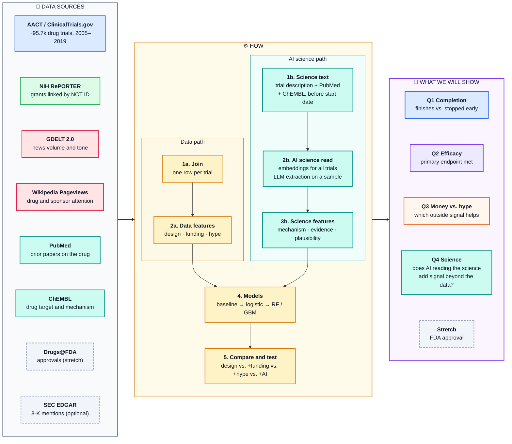

# DrugTrialPredictor

> **Research question:** At the moment a drug trial is registered, can we predict whether it will finish and whether it will work? And do money (NIH grants), hype (news, Wikipedia), or an AI reading of the science tell us anything the trial design doesn't?



Predicting whether a clinical drug trial will succeed, using trial design data from ClinicalTrials.gov combined with NIH grant funding data, news and public-attention ("hype") signals, and an AI reading of the science behind each trial.

## Objective

Roughly 1 in 5 drug trials that reach a final status is terminated or withdrawn. If we can predict at registration time which trials are likely to stop early, sponsors, funders, and patients get an early risk signal.

A trial that *finishes* is not the same as a drug that *works*: most terminations happen for operational reasons like slow enrollment, not because the drug failed (Williams et al. 2015). So we model both questions separately, then ask what kind of outside signal helps:

- **Q1 (completion):** can trial design features predict whether a trial completes or is stopped?
- **Q2 (efficacy):** among completed trials with posted results, can the same features predict whether the trial met its primary endpoint? Do the important features differ from Q1?
- **Q3 (money vs. hype):** do funding and track record (NIH grants) or public attention (news, Wikipedia) improve either model beyond design features alone?
- **Q4 (science):** does an AI reading of the science (how the drug works, how strong the earlier evidence is) add signal beyond the structured data?

See [docs/related-work.md](docs/related-work.md) for prior work and how this project differs.

## Unit of analysis and targets

- **Row:** one interventional drug trial registered on ClinicalTrials.gov with a final status and a start date from 2005 through 2019. The 2019 cutoff avoids survivorship bias: recent trials that have already finished are disproportionately short ones.
- **Target A (Q1, binary):** `completed` = 1 if `Completed`, 0 if `Terminated` or `Withdrawn`. Ongoing trials are dropped because their outcome is unknown. Withdrawn trials (never enrolled) may be modeled separately from terminated ones.
- **Target B (Q2, binary):** `met_primary` = 1 if the primary outcome analysis reports p < 0.05, from AACT `outcome_analyses`. Only trials with posted results and a primary-outcome p-value are included. The HINT benchmark labels (Fu et al. 2022) are a fallback or cross-check.
- **Stretch:** join Drugs@FDA to label FDA approval for the subset of trials we can match to an approved product.

- **Cohort rule:** keep only trials registered no later than 90 days after their start date. About 15% of completed trials were registered more than a year after starting (often after finishing), vs. 3% of withdrawn ones, so late registration would let the model learn the outcome from the registration date.

### Row counts

From AACT on 2026-10-29: interventional trials with at least one drug intervention, start date 2005-01-01 to 2019-12-31.

| Group | Raw pull | Cohort (registered ≤ 90 days after start) |
| --- | --- | --- |
| Completed | 78,053 | 58,552 |
| Terminated | 13,331 | 11,354 |
| Withdrawn | 4,342 | 3,936 |
| **Target A** | **95,726** (18.5% stopped) | **73,842** (20.7% stopped) |
| **Target B** (completed, primary-outcome p-value posted) | 10,274 | 9,030 |

## Data sources

All sources are free, public, and legal. None are synthetic.

| Source | What it gives us | Access |
| --- | --- | --- |
| [AACT](https://aact.ctti-clinicaltrials.org/) (ClinicalTrials.gov) | Core trial table: phase, design, sponsor, enrollment, sites, conditions, status, posted results | Free account; Postgres connection or static download |
| [NIH RePORTER / ExPORTER](https://reporter.nih.gov/exporter) | NIH grants linked to the ClinicalTrials.gov trials they support (Clinical Studies file, joined on core project number): award amount, funding institute, activity code, PI history, abstracts | Bulk CSV download; no account |
| [PubMed](https://pubmed.ncbi.nlm.nih.gov/) | Abstracts of papers about each drug published before the trial started, for the AI science read | Free NCBI E-utilities API |
| [ChEMBL](https://www.ebi.ac.uk/chembl/) | Drug targets, mechanism of action, and highest prior development phase | Bulk download or free REST API |
| [Drugs@FDA](https://www.fda.gov/drugs/drug-approvals-and-databases/drugsfda-data-files) | Approval records for the stretch FDA label | Bulk download |
| [GDELT 2.0](https://www.gdeltproject.org/) | Global news coverage counts and pre-computed tone per drug/sponsor over time (2015+) | Raw CSV files or Google BigQuery public dataset |
| [Wikimedia Pageviews API](https://wikimedia.org/api/rest_v1/) | Daily page views for drug, sponsor, and condition articles (mid-2015+) | Free REST API |
| [SEC EDGAR](https://www.sec.gov/edgar) (optional) | Count of 8-K filings mentioning a drug, for public-company sponsors | Free API |

## Features

**Trial design (AACT):** phase, anticipated enrollment, sponsor class (industry / NIH / academic), number of sites and countries, condition category (MeSH), allocation, masking, intervention model, number of arms, has data monitoring committee, start year, number of collaborators, biomarker-based patient selection (from eligibility text; Wong et al. 2019 found it raises success rates).

**Funding and track record (NIH RePORTER):** has NIH grant, total award amount, funding institute (NCI, NHLBI, ...), activity code (R01, U01, ...), number of linked grants, and the PI's and organization's prior grant and trial counts. These cover the academic trials that hype data mostly misses. Only grants awarded before the trial start date count.

**Hype (news / attention):** news article count and average tone in the window before trial start, Wikipedia page views for the drug and sponsor, attention trend (growth rate), and a `has_news` flag. GDELT tone is already computed, so no heavy NLP is needed.

**Science (AI read):** an AI reads each trial's description together with PubMed abstracts and ChEMBL records dated before the trial start. Two layers:

- *Embeddings for every trial:* a biomedical language model (BioBERT or PubMedBERT) turns the text into vectors, reduced with PCA. Runs locally for free on all trials.
- *LLM extraction on a sample of a few thousand trials:* an LLM fills in structured fields: mechanism of action class, new vs. known target, whether a successful earlier-phase trial is cited, number of supporting prior papers, surrogate vs. clinical endpoint, and a 1–5 scientific plausibility score. The LLM extracts facts; it is never asked to predict the outcome directly.

## Leakage rules

Every feature must be knowable at or before trial start:

- Use **anticipated** enrollment, not actual. AACT overwrites `enrollment` with the actual count when a trial ends (withdrawn trials become 0), so the original anticipated value has to come from ClinicalTrials.gov record history, or the feature is dropped.
- **Site and country counts are excluded.** 34% of withdrawn trials list zero sites (vs. 4–7% of others), because sites get removed after the fact. Adding them inflates ROC-AUC by about 0.04; the model results keep this as a labeled leakage check only.
- **Registration lag is not a feature** (only the cohort filter uses it). Withdrawn trials keep a *planned* start date that is often pushed back before cancellation, so the lag records postponements that happen after registration.
- **Sponsor track record** counts only the sponsor's trials that started, or ended, before this trial's start date.
- Exclude `why_stopped`, posted results, completion dates, and anything updated after the outcome, except when building labels.
- Grant and hype features are measured only in a fixed window **before** the trial's start date. Coverage after a termination is announced would leak the answer.
- AI science features use only text written before the trial start: PubMed papers dated before it, and the trial description as first posted (from record history where possible, since sponsors can edit it later).
- LLMs trained after 2019 may already know how a trial ended. We ask the LLM to recall the outcome for a sample of trials; if it often can, we flag those trials and lean on the embedding features instead.

## Planned pipeline

1. **Ingest:** pull AACT tables (`studies`, `designs`, `sponsors`, `facilities`, `conditions`, `interventions`, `eligibilities`, `outcomes`, `outcome_analyses`) and the NIH ExPORTER projects and clinical studies files; save snapshots locally.
2. **Wrangle and join:** build one row per trial with SQL joins and aggregations. Join NIH grants on NCT ID through the clinical studies link. Normalize drug names (regex) to match against GDELT, Wikipedia, and Drugs@FDA.
3. **Hype join:** for each trial, aggregate news and page-view metrics over the pre-start window.
4. **AI science read:** pull pre-start PubMed abstracts and ChEMBL records per drug, embed trial text and abstracts for all trials, and run LLM extraction on a sample.
5. **EDA:** termination rate by phase, sponsor type, disease area, and year; funding, hype, and science-feature distributions; each against outcome.
6. **Modeling:** a phase + disease-area baseline, then logistic regression, then tree ensembles (random forest, gradient boosting). Handle class imbalance with class weights. Report ROC-AUC, PR-AUC, and F1. Ablation: design only vs. design + funding vs. design + hype vs. design + AI science vs. all.
7. **Hypothesis tests (permutation):**
   - H1: termination rate differs between industry and academic sponsors.
   - H2: high-hype trials have a different success rate than low-hype trials (within the industry subset, to avoid confounding).
   - H3: NIH-funded trials have a different completion rate than comparable academic trials without NIH funding.
   - H4: trials with a high LLM plausibility score meet their primary endpoint more often than trials with a low score.

## Running the code

```bash
pip install -r requirements.txt && pip install -e .
cp .env.example .env            # add your AACT username/password

# 1. Ingest: one row per trial from AACT (live Postgres, or the static flat-file download)
python -m dtp.ingest.aact --source postgres
#   or: unzip the AACT flat files into data/raw/aact/ and
#   python -m dtp.ingest.aact --source flatfiles

# 2. Labels + design features  -> data/processed/trials.parquet
python -m dtp.features

# 2b. Optional joins (cached under data/raw/, resumable; rerun step 2 afterwards)
python -m dtp.ingest.nih      # NIH grants linked to trials (~5 min)
python -m dtp.ingest.hype     # Wikipedia pageviews per drug (~75 min, one request/second)

# 3. Baselines, models, ablation -> data/processed/results_<target>.csv
python -m dtp.models --target completed
python -m dtp.models --target met_primary

# 4. Full analysis: EDA, hypothesis tests, models, diagnostics
jupyter lab notebooks/drug_trial_predictor.ipynb
```

| Path | What it does | Status |
| --- | --- | --- |
| `notebooks/drug_trial_predictor.ipynb` | Main analysis: cohort, EDA (10 figures), hypothesis tests, models, diagnostics | Runs end to end |
| `sql/trials.sql` | One row per trial from 13 AACT tables (design, arms, planned outcomes, MeSH, eligibility, Target B p-values) | Working |
| `sql/sponsor_history.sql` | Every interventional trial + lead sponsor (~460k rows) for track-record features | Working |
| `src/dtp/ingest/aact.py` | Runs the queries on AACT Postgres (~40 s) or on flat files via DuckDB | Working |
| `src/dtp/features.py` | Labels, cohort filter, design + disease-area + eligibility features, sponsor track record, why-stopped categories | Working |
| `src/dtp/models.py` | Time split, baselines, logistic / RF / gradient boosting, ablation, permutation importance, per-group AUC | Working |
| `src/dtp/stats.py` | Permutation tests H1–H4 | Working (H2 needs the Wikipedia fetch) |
| `src/dtp/ingest/nih.py` | ExPORTER grant-trial links + RePORTER API grant-years, pre-start only | Working |
| `src/dtp/ingest/hype.py` | Drug-name normalizer, Wikipedia monthly pageviews per drug; GDELT is a TODO | Wikipedia working; GDELT not started |

Anticipated enrollment is **not** a feature yet: AACT's `enrollment` is the final count (leaky), so it's kept as `post_enrollment_final` for EDA only.

### Results so far

Test set: trials that started 2016–2019 (trained on 2005–2015). ROC-AUC, best model per row:

| Features | Q1: completed | Q2: met primary endpoint |
| --- | --- | --- |
| Phase + disease-area baseline | 0.62 | 0.64 |
| Design | 0.66 | 0.73 |
| Design + sponsor track record | **0.68** | 0.73 |
| + NIH funding | 0.68 | — |
| *+ site counts (leakage check, not a real model)* | *0.73* | — |

- **Why trials stop:** about 34% for enrollment problems and 18% for business reasons; only 6% for efficacy and 4% for safety.
- **Sponsor track record** is the strongest single signal for completion. Trials from sponsors in the worst-record quintile stop 2.6× as often as those in the best (33% vs 13%). It adds nothing for efficacy.
- **H1:** industry trials complete 9 percentage points more often than academic ones (permutation p ≈ 1e-4).
- **H3 / funding:** academic trials with an NIH grant complete 4 points more often (p ≈ 1e-4), but funding adds no predictive power once design and sponsor track record are in the model.
- **Anticipated enrollment** can't be recovered: ClinicalTrials.gov's record-history endpoint isn't public (HTTP 403).

## Anticipated challenges

- **Sparse hype coverage.** Most academic trials get zero news. Hype features will mostly matter for industry trials of named drugs, so we will report results on that subset and include a `has_news` flag.
- **Funding coverage.** NIH grant links cover academic and NIH-supported trials, not industry trials. Funding features apply to that subset, with a `has_nih_grant` flag.
- **Entity matching.** Drug names vary (brand vs. generic vs. code names like `ABC-123`). Matching across sources needs regex cleanup and alias tables.
- **Termination isn't always failure.** Many trials stop for business or enrollment reasons, which is why Target B exists.
- **Anticipated enrollment.** AACT keeps only the final value; recovering the original may require record history for a sample.
- **AI memorization.** An LLM may recognize famous trials and their results. The recall check and the embedding-only comparison guard against this.
- **AI cost.** LLM calls on ~95k trials are expensive, so LLM extraction runs on a sample and embeddings cover the rest.
- **Class imbalance.** About 79% of cohort trials complete.
- **Censoring.** Stop rates rise from about 20% to 26% across 2016–2019 partly because unfinished long trials aren't in the data yet; the test years have a higher base rate than the training years.
- **Time coverage.** GDELT and Wikipedia pageviews start around 2015, so hype features only exist for 2015–2019 trials.

## Milestones

| Milestone | Date |
| --- | --- |
| Proposal | Oct 30 |
| EDA + baseline done | Nov 20 |
| Final analysis and write-up | Dec 7 |

## Team

| Member | Responsibilities |
| --- | --- |
| TBD | Data ingestion (AACT) and joins |
| TBD | Funding (NIH RePORTER) and hype data (GDELT, Wikipedia), entity matching |
| TBD | AI science read (PubMed, ChEMBL, embeddings, LLM extraction) |
| TBD | EDA and hypothesis testing |
| TBD | Modeling and evaluation |
