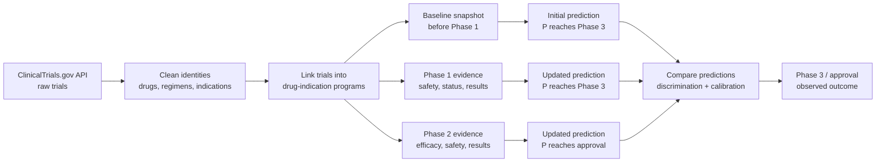

# Phase-by-Phase Drug Development Prediction

This project extension reorganizes clinical-trial data around a longitudinal
**drug-indication program** rather than treating every registered trial as an
independent observation.

**Current status: first-pass data-cleaning prototype, not model-ready.**
See [Implementation status](STATUS.md) for the verified milestone, audit counts,
and known limitations. The schema and modeling sections below describe the
target design; they are not all implemented yet.

## Project schematic



The first implementation milestone covers the left side of this diagram:
downloading real studies, cleaning identities, linking trials to programs, and
evaluating whether those links are structurally sound. Modeling is intentionally
held until the data audit passes.

## Research question

> Given the information available at a specific point in development, how far
> will a drug-indication program progress, and how does that prediction change
> after Phase 1 and Phase 2 evidence becomes available?

## Unit of analysis

The primary entity is a drug-indication program:

```text
program_id = normalized drug + normalized indication
```

A drug studied for two indications is represented by two programs. A program
may contain multiple trials within the same phase.

## Prediction checkpoints

1. **Baseline:** information available before Phase 1 begins.
2. **After Phase 1:** baseline information plus Phase 1 design, status, timing,
   enrollment, safety, and available results.
3. **After Phase 2:** all earlier information plus equivalent Phase 2 evidence.

Every feature must have been observable by its checkpoint date. Later-phase
information must never be included in an earlier prediction.

## Primary outcome

The initial primary outcome is whether a program eventually reaches Phase 3.
Secondary outcomes include:

- Reaching Phase 2
- Receiving FDA approval
- Highest phase reached
- Time to the next phase
- Apparent discontinuation

Programs without enough follow-up will be marked as censored rather than
automatically labeled as failures.

## Planned data products

The pipeline will produce four connected tables:

1. **Trials:** one row per ClinicalTrials.gov study.
2. **Programs:** one row per drug-indication program with final outcomes.
3. **Phase history:** one row per program and clinical phase.
4. **Snapshots:** one model-ready row per program and prediction checkpoint.

## Data organization

The tables form a star-like structure in which raw trials are preserved and
modeling rows are derived reproducibly:

```text
trials ──┐
         ├──> program_trials ──> programs ──> phase_history ──> snapshots
drugs  ──┤
diseases─┘
```

### `trials`

One row per NCT ID. This extends the existing trial table without replacing it.

Required keys and dates:

- `nct_id`
- `start_date`
- `first_submitted_date`
- `completion_date`
- `phase`
- `overall_status`

Trial design, sponsor, eligibility, funding, science, and result fields remain
at this level. Each field will also be classified as baseline, post-start, or
post-result so that future information cannot leak into earlier snapshots.

### `drugs`

One row per canonical active ingredient or biologic. It maps spelling variants,
brand names, development codes, and intervention aliases to a stable `drug_id`.
Placebos and non-drug interventions are excluded. Combination regimens retain
their component IDs and receive a separate, deterministic `regimen_id`.

### `diseases`

One row per controlled indication concept. Raw condition strings map to a stable
`indication_id`, preferably through MeSH concepts already present in AACT. Broad
disease-area categories are features, not substitutes for the indication.

### `programs`

One row per regimen-indication program:

```text
program_id = regimen_id + indication_id
```

Important fields include the first observed development date, first phase,
highest observed phase, latest follow-up date, maturity/censoring flags, and
the final transition labels.

### `program_trials`

A bridge table connecting trials to programs. This is necessary because a
trial can study multiple drugs or conditions, and a program can contain many
trials. Ambiguous many-to-many rows are flagged for sensitivity analysis rather
than silently forced into a single program.

### `phase_history`

One row per `program_id` and standardized phase. It aggregates only information
available by the end of that phase, including the number of trials, enrollment,
duration, completion/termination counts, posted results, primary-outcome
evidence, and safety information.

### `snapshots`

One row per program and checkpoint. This is the model input table.

| Key | Meaning |
| --- | --- |
| `program_id` | Grouping key; never used as a predictive feature |
| `checkpoint` | `baseline`, `after_phase1`, or `after_phase2` |
| `cutoff_date` | Latest date from which features may be used |
| feature columns | Evidence observable on or before `cutoff_date` |
| `reached_phase3` | Primary binary label |
| `approved` | Secondary binary label |
| `highest_phase` | Secondary ordinal label |
| `event_date` | Date of advancement or approval, when observed |
| `censored` | Outcome is not yet mature enough to call a failure |

## Cleaning and cohort rules

1. Normalize phase names, including `EARLY_PHASE1` and combined phases such as
   `PHASE1/PHASE2`, using a documented ordering rule.
2. Canonicalize drug and indication identities before grouping trials.
3. Keep combination regimens distinct from their individual components.
4. Deduplicate NCT IDs and exact duplicate intervention/condition mappings.
5. Preserve missingness indicators; do not convert unknown values to zero.
6. Exclude observational and non-drug studies from the modeling cohort.
7. Assign every feature an availability date and reject features dated after
   the snapshot cutoff.
8. Mark programs with insufficient follow-up as censored. Do not label a recent
   Phase 1 or Phase 2 program as a failure merely because it has not advanced.
9. Produce an auditable funnel showing row counts after every cleaning step.
10. Manually review a reproducible sample of linked programs before modeling.

## Model input and prediction flow

Each snapshot row is converted to numbers inside a training-only pipeline:

```text
snapshot row
  ├── numeric fields -> clip -> median impute + missing flags -> standardize
  ├── categorical fields -> group rare values -> one-hot encode
  └── text fields -> optional training-fitted embedding/PCA representation
                         ↓
                 classification model
                         ↓
          predicted probability of advancement
```

The first primary comparison will use the same eligible programs at two
checkpoints:

```text
baseline features       -> Model A -> P(reaches Phase 3)
baseline + Phase 1 data -> Model B -> P(reaches Phase 3)
```

This directly tests whether Phase 1 evidence improves predictions rather than
merely whether a large model can fit historical data.

All snapshots from the same program, drug/regimen, and closely related aliases
must remain in the same data split. The main evaluation will also be
chronological: older programs for training, intermediate years for validation,
and newer mature programs for testing.

## Statistical evaluation

Model quality and scientific inference answer different questions:

- **Prediction:** ROC-AUC, precision-recall AUC, log loss, Brier score, and
  calibration on the untouched chronological test set.
- **Uncertainty:** program-grouped bootstrap confidence intervals for metrics
  and individual predicted probabilities.
- **Incremental value:** paired, program-grouped bootstrap comparison of Model
  B against Model A.
- **Interpretation:** prespecified logistic-regression odds ratios with 95%
  confidence intervals and multiple-testing-adjusted p-values.

P-values will not be described as confidence in an individual prediction. A
reported 75% probability will instead be supported by its bootstrap interval,
calibration among similar predictions, and improvement over the baseline rate.

## Feasibility checkpoint

Before training, the audit must report for each checkpoint and outcome:

- Total unique programs
- Positive, negative, and censored outcomes
- Number of programs with multiple trials per phase
- Missingness for every proposed feature
- Counts by phase, start year, disease area, and sponsor class
- Number of outcome events per proposed model parameter

Phase 3 advancement remains the primary outcome only if the cleaned cohort has
enough mature positive and negative programs. FDA approval will remain a
secondary or exploratory outcome if approvals are too sparse.

## How we make sure the code is correct

Correctness is checked at three different levels. Passing a unit test does not
by itself prove that the real dataset is scientifically valid, so each level
answers a different question.

### 1. Unit tests: does each function behave as specified?

Run the complete suite from the repository root:

```bash
pytest -q
```

Pytest discovers both the original project tests and the phase-by-phase tests
through `pyproject.toml`. Each `test_...` function creates a small input with a
known correct answer, calls the production function, and uses assertions to
compare the actual result with that answer.

The identity tests cover:

- Phase spelling and combined-phase normalization
- Removal of placebo/sham interventions
- Stable ordering of combination regimens
- Preference for controlled indication terms
- Deduplication and deterministic program IDs
- Explicit flags for trials with multiple indications
- Evaluation behavior when mapping coverage is poor

A failed assertion stops the suite and prints the exact input expectation that
was violated. Tests must pass before a cleaning change is accepted.

### 2. Data-quality evals: does the code behave safely on real records?

The first-step pipeline writes both JSON and Markdown evaluation reports. These
evals check invariants that must always hold:

- The bridge table is not empty
- Key columns contain no nulls
- Trial-program pairs are unique
- A `program_id` never represents two different regimen-indication pairs
- Placebo/sham labels do not survive as active regimen components
- Mapping coverage is measured and warned on if below 80%
- Multi-indication trials are counted and surfaced for review

The report distinguishes `PASS`, `WARN`, `INFO`, and `FAIL`. A warning is not
silently treated as success; it becomes an explicit cleaning decision.

### 3. Scientific review: are the links meaningful?

Automated checks cannot prove that two names represent the same molecule or
that a broad condition belongs to one indication. Before modeling we will:

1. Draw a reproducible random sample of linked programs.
2. Review drug aliases, combinations, and indication assignments manually.
3. Measure agreement and record corrections in versioned alias tables.
4. Re-run the eval report after every mapping change.
5. Compare cohort counts before and after each exclusion rule.

This is also why the first cleaner performs conservative text normalization but
does not yet guess that brand names and development codes are molecular aliases.

### Running the real-data first step

The public ClinicalTrials.gov API requires no private credentials. From the
repository root:

```bash
PYTHONPATH=phase-by-phase/src \
python3 -m phase_by_phase.run_first_step --max-studies 1000
```

This command:

1. Downloads real interventional Phase 1-3 study records.
2. Saves the raw response and derived Parquet inputs under
   `data/raw/phase_by_phase/`.
3. Builds `data/processed/phase_by_phase/program_trials.parquet`.
4. Writes `identity_eval.json` and the human-readable `identity_eval.md`.

The data directories are intentionally ignored by Git because the files are
large and regenerable. Code, tests, and documentation remain version-controlled.
Fresh API downloads are not guaranteed to return the same sample; see
[reproducibility limitations](STATUS.md#remaining-work-before-modeling).

## Initial modeling plan

- Begin with interpretable logistic-regression baselines.
- Split data chronologically and keep all rows from a program in one split.
- Compare baseline predictions with predictions updated after Phase 1.
- Report discrimination, calibration, Brier score, log loss, and bootstrap
  uncertainty intervals.
- Report odds ratios, confidence intervals, and corrected p-values for
  prespecified explanatory features.

## Proposed structure

```text
phase-by-phase/
├── README.md
├── config/
├── notebooks/
├── outputs/
├── src/
└── tests/
```

The next step is to audit the existing data pipeline, count usable programs at
each checkpoint, and document the cleaning rules before training a model.
