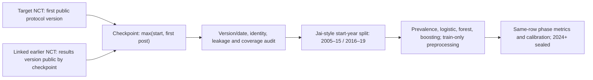
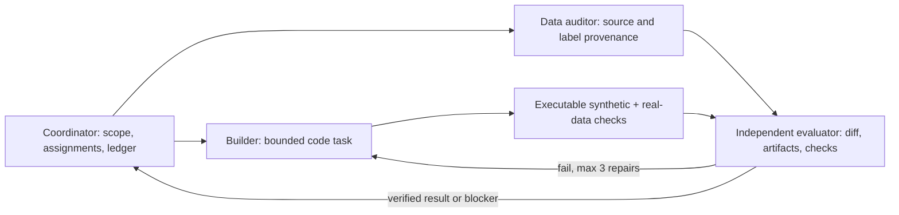
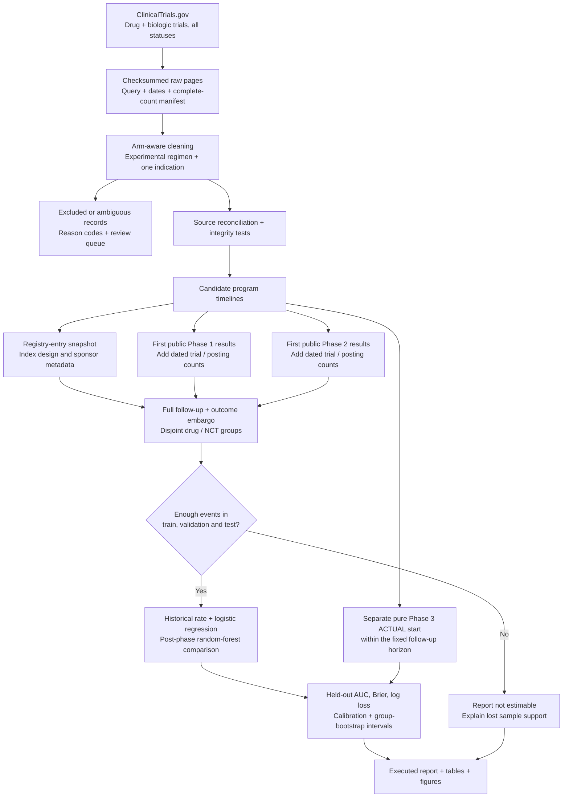

# Leo/Giannis: Phase-by-Phase Drug Trial Prediction

> **Data-source switch (2026-11-25):** The primary pipeline is moving to the
> [Anamnesis Clinical Trials Version History](https://huggingface.co/datasets/anamnesis-data/clinical_trials_history)
> dataset. Terminal access is authenticated and the complete pinned release
> (`8bba65094c7d11a0a66924fab556ba971d456cef`) has been downloaded locally:
> 79 tables, 1,135 Parquet files, 613,411 NCTs and 4,496,043 `core` versions.
> A 15-NCT, phase-stratified real-source cleaning pilot and full phase/arm,
> alias and result cleans have run; both full-output evaluations passed.
> The older public
> 20-trial sample has a different schema and cannot establish full-release coverage.
> The historical-version **development-only** model run is documented below.
> Older AACT/current-record experiments remain separately labeled and must
> not be presented as historical-version results.
> AACT remains an unchanged comparison source. See the
> [source-switch ledger](harness/TASK_LEDGER.md#historical-version-source-switch-2026-11-25)
> for the fixed pilot and validation gates. The planned tables, cleaning
> choices, features, labels, exclusions and audit checks are explained in
> [Historical data decisions](HISTORICAL_DATA_DECISIONS.md).

The [cleaned-data structure and category guide](HISTORICAL_CLEANED_SCHEMA.md)
shows the arm, intervention, result, and text tables, their keys, and which
source categories remain raw rather than normalized.

**Overnight structured-data checkpoint (2026-11-27):** A resumable,
SQLite-backed [supervisor](harness/SUPERVISOR.md) now runs bounded Codex tasks
with saved attempts, usage preflight, and independent acceptance evidence. Its
first supervised real-data task was the [B19 endpoint audit](harness/B19_AUDIT.md),
not a new efficacy model. The [independent evaluation](harness/B19_INDEPENDENT_EVALUATION.md)
passed 55 focused and 309 full-suite tests and verified the pinned inputs,
output hashes, unique keys, deterministic review sample, and pre-2024 dates.
The supervisor is a **foundation**, not yet a fully unattended scientific
dispatcher; interrupted work remains unreviewed until an operator checks it.

The B19 audit covers **8,414** selected Phase 3 trial versions and **15,295**
primary outcomes, retaining exact version/child keys and **120** actual-trial
review records. Of the 8,414 trials, 6,006 have one primary endpoint and 4,212
have a primary p-value recorded somewhere; these conditions alone do not prove
benefit. At outcome grain, 1,713 have an explicit treatment/comparator role
contrast, but that is still a structural candidate, not clinical validation.
The historical analysis-type field distinguishes superiority, non-inferiority,
equivalence, and ambiguous combined categories; a failed pilot that conflated
them was preserved and repaired before the full replay. **No new efficacy
labels, model scores, or 2024+ holdout results were produced.**

**Drug-identity evidence pilot (B20, 2026-11-27):** The
[bridge implementation](src/phase_by_phase/bridge_b20.py) preserves each sampled
historical trial/version, arm, intervention, alias, arm–intervention assertion,
and exact-version condition as separate inspectable records. On 150 selected
development-only Phase 3 trial versions it found 369 normalized recorded drug
names. A bounded public ChEMBL query attempted the first 200 names, with 189
successful responses, 11 name-level failures, 67 truncated searches and 169
names outside the budget. The
[independent network evaluation](harness/B20_NETWORK_EVALUATION.md) verified
all source/cache hashes and a byte-identical offline replay; the
[HTTPS-repair evaluation](harness/B20_REPAIR1_EVALUATION.md) passed 40 focused
tests, 349 project tests, the harness, and a live verified-HTTPS smoke test.
A local, Git-ignored review sheet contains **candidate** matches only. No molecule has been clinically verified,
and contemporary ChEMBL data have not been made historical predictors. This
enriched sample and alphabetical query budget cannot estimate population
coverage or candidate precision. Unqueried, failed and truncated names remain
unknown. The [task ledger](harness/TASK_LEDGER.md#b20-bounded-drug-identity-bridge-pilot-pre-registered-2026-11-27)
records the original CA failure and bounded repair.

The development-only [B22 proxy audit](harness/B22_PROXY.md) and its
[independent evaluation](harness/B22_INDEPENDENT_EVALUATION.md) have now run.
From **19,576** first-public Phase 3 targets, exactly **297** have a narrow,
traceable reported primary superiority-p proxy: **170 below 0.05**, **127 at
or above 0.05**, and **19,279 unknown**. The first output was rejected because
nullable source keys became floating-point; the repaired output preserves
integer keys, passed a large-key regression and a byte-identical independent
full replay, plus 34 focused and 393 full-suite evaluator tests and the
harness. The proxy says only what a reported statistical test said; it does
**not** establish effect direction, clinical benefit, or approval. No known
label was public before 2016, and the later rolling cohorts fail the fixed
training/validation support gates, so **no new model or AUC was produced**.

A separate [B23 probability-sampled coverage pilot](harness/B23_COVERAGE.md)
and [independent evaluation](harness/B23_INDEPENDENT_EVALUATION.md) have run
on **100** first-public Phase 3 records. All **229** recorded drug names were
accounted for in 393 bounded ChEMBL attempts, with a byte-identical offline
replay. Among those **100 sampled trials only**, 47 had at least one complete
exact-name *candidate* search, 20 had complete searches with no candidate,
and 33 remain unknown; **47%–80%** is a within-sample partial-identification
range, not a population estimate or verified drug-match rate. The reviewer
found a real arm-link disagreement between the source's two assertion
directions, preserved in the output. Contemporary ChEMBL evidence is not a
historical model feature. Because 33 trial statuses remain unresolved, the
independent pass **does not authorize the planned 400-trial scale-up**; a new
acquisition and uncertainty plan is needed first.

**Current status:** Historical cleaning and first-public design staging are
complete, and fixed-split and rolling-year development-only model comparisons
have run. The five
protocol and 37 result tables were independently checked against the full
source. The first-public design summary does not replace those detailed tables
or their original text and NCT/version/ordinal keys. No text embeddings,
earlier-phase evidence features, calibrated individual probabilities, or
2024+ final-holdout evaluation have run. The new Phase-1-results-to-Phase-3-
significance feasibility audit found no linked trials with a usable target
p-value, so it trained no additional model. A subsequent conservative
structured Phase 3 evidence grader ran on development data, but produced zero
supported-benefit labels; its downstream models were therefore not fit. A
drug-name candidate linkage and first-Phase-3-landmark rollup have also run
on the full development cohort. Those rollups are **retrospective inspection
tables, not training-ready features**; see the B18 audit below. The raw archive
is Git-ignored.

The new source has one `core` row per trial **version**, not one row per trial.
For each prediction checkpoint we will select the most recent *publicly posted*
version at or before that date, then join `phases`, `interventions`, `conditions`,
and protocol child rows using both `nct_id` and `nct_version`. A later version
may establish the label, but cannot supply that trial's earlier features. A
separate results-version join will establish when an earlier trial's primary
analysis became public. Completion and reported primary p<.05 remain separate
targets; missing results are unknown. Month-only dates retain their precision.
The development holdout remains sealed until the feature code and settings are
frozen. The dataset is CC BY-NC 4.0; cite Anamnesis Data and attribute the
underlying records to ClinicalTrials.gov.

## Drug-level Phase 1/2 to Phase 3 linkage (B18, 2026-11-25)

The [linkage code](src/phase_by_phase/drug_level_candidates.py) and
[focused tests](tests/test_drug_level_candidates.py) implement a **candidate**
version of “Drug X → all earlier Phase 1/2 trial arms → first Phase 3
checkpoint → later Phase 3 grades.” This is a completed development-data
linkage audit, **not** a trained efficacy predictor or verified molecular
identity map.

1. Start from the 19,576 B15 pure-Phase-3 NCTs with first-public dates before
   2020. The prediction checkpoint is each NCT's first-public Phase 3 design
   date. Use the same historical `(nct_id, nct_version)` for interventions,
   arms, and arm–intervention links.
2. Normalize the recorded DRUG name conservatively. Exclude obvious
   placebo/control names. A primary candidate needs an explicit, resolved
   link to a **single-drug experimental arm** that is not also linked to a
   nonexperimental arm. Unlinked names, multiple drugs in one arm, and alias
   collisions remain review rows, not verified matches. We do **not** merge
   aliases or claim that identical strings prove the same active ingredient.
3. For each Phase 3 checkpoint, gather **all** candidate-matched Phase 1 and
   Phase 2 arms whose first-public designs predate it. Check the latest whole
   public record version strictly before that checkpoint for a primary result;
   a removed result is not carried forward. Serious-adverse-event data count
   only as denominator-valid *coverage*, not an event rate or efficacy claim.
   Original trial, version, arm, intervention, source-file and result-date keys
   remain in the child tables for inspection.
4. Attach B17's later Phase 3 efficacy grade **only as a label**. One row per
   Phase 3 target×candidate drug is saved, plus one descriptive row per
   candidate drug at its first Phase 3 checkpoint. Multi-active-drug Phase 3
   trials are flagged rather than attributing their whole-trial grade to each
   ingredient. Missing or ungradable grades are unknown, never failures.

| Full development replay | Rows or NCTs | What it means |
| --- | ---: | --- |
| Phase 3 starting NCTs | 19,576 | B15 development cohort; 2024+ holdout not read |
| NCTs with any candidate drug name | 19,366 | Includes unlinked/review-only names |
| NCTs with conservative experimental-arm candidate | 9,499 | Still not clinically verified drug identity |
| Target×drug landmarks / unique candidate-drug rollups | 10,396 / 6,300 | Different grains; do not equate rollups with trials |
| Earlier Phase 1/2 arm contribution rows | 27,298 | Inspectable, dated child records |
| Landmarks with a dated prior Phase 1 / Phase 2 primary result | 221 / 676 | 70/151 and 235/441 in train/validation respectively; these are target×drug rows |
| Linked landmarks with a B17 result grade | 5,086 | 5,071 ungradable; 15 assessable but **zero supported-benefit** |

**Leakage gate:** The [drug rollup](data/processed/anamnesis_drug_candidates_b18_full_v2_2026-11-25/drug_rollup.parquet)
is **retrospective descriptive output, not a training table**. Its aggregate
label counts can include Phase 3 reports published after the training split's
2016 cutoff; independent evaluation found nine such assessable train-assigned
target×drug grades. Also, 442 candidate drug keys appear in both chronological
target-row splits. A future model must rebuild labels available at each
training cutoff and keep each drug/program group out of both sides of a split.
The current run fits **no** random forest or gradient boosting model: chemical
identity/indication links are unverified and B17 has zero supported-benefit
positives. There is no AUC to report. “At least one positive trial” would also
bias comparisons toward heavily tested drugs; future outcomes should report
assessable numerator **and denominator**, by indication where identity can be
validated.

The [full report](data/processed/anamnesis_drug_candidates_b18_full_v2_2026-11-25/report.json),
[target-level landmarks](data/processed/anamnesis_drug_candidates_b18_full_v2_2026-11-25/drug_landmarks.parquet),
[prior contributions](data/processed/anamnesis_drug_candidates_b18_full_v2_2026-11-25/prior_contributions.parquet),
and [candidate exposures](data/processed/anamnesis_drug_candidates_b18_full_v2_2026-11-25/candidate_exposures.parquet)
are local Git-ignored inspection artifacts. The full command was:

```bash
PYTHONPATH=phase-by-phase/src .venv/bin/python -m phase_by_phase.drug_level_candidates \
  --cohort phase-by-phase/data/processed/anamnesis_rolling_b15_full_v1_2026-11-25/development_rows.parquet \
  --design phase-by-phase/data/processed/anamnesis_first_public_design_full_b12_hash_verified_2026-11-25/first_public_design_summary.parquet \
  --protocol phase-by-phase/data/processed/anamnesis_full_b11a_repair2_2026-11-25 \
  --results phase-by-phase/data/processed/anamnesis_full_b11b_2026-11-25 \
  --grades phase-by-phase/data/processed/anamnesis_grade_b17_full_v3_2026-11-25/graded_trials.parquet \
  --core phase-by-phase/data/raw/anamnesis/full_8bba6509_2026-11-25/core \
  --out phase-by-phase/data/processed/anamnesis_drug_candidates_b18_full_v2_2026-11-25
```

The output directory is immutable: use a new directory for a replay. Focused
tests: **7 passed**; full suite: **246 passed**; harness: **PASS**.
Independent artifact checks found no future-dated prior contributions, no
2024+ result dates, no duplicate drug rollup keys and no nonexperimental prior
contributions. The [task ledger](harness/TASK_LEDGER.md) records the repair
rounds and evaluation caveat.

## Structured Phase 3 evidence grading (B17, 2026-11-25)

The [grader](src/phase_by_phase/grade_structured_efficacy.py) and
[focused tests](tests/test_grade_structured_efficacy.py) now organize posted
Phase 3 results **without NLP**. This is a label-construction audit, not a new
prediction score. It uses only B15's pre-2020, first-public, recorded-DRUG,
pure Phase 3 development NCTs and pre-2024 historical result versions. For
each NCT, it selects the earliest posted version *after* the trial checkpoint
that contains a primary measurement or analysis, then joins every child table
on the exact `(nct_id, nct_version)` and outcome/analysis/group keys. It saves
the source rows, date, effect values, p-value, group IDs and a reason code.
Later Phase 3 results are **labels only**; they are never attached to Phase 1
or Phase 2 predictor rows.

| Real development cohort | Count | Meaning |
| --- | ---: | --- |
| Pure Phase 3 targets | 19,576 | Same B15 development starting cohort |
| Selected first primary-result versions | 8,414 | Dated result version with measurement or analysis; not all are gradable |
| At least two numeric primary-result groups | 7,199 | Two groups need not be verified treatment/control |
| Primary analysis / p / CI present | 4,731 / 4,212 / 3,676 | Overlapping evidence-availability counts, not success labels |
| Ungradable / directional only / benefit not demonstrated / supported benefit | 8,388 / 17 / 9 / **0** | Strict efficacy-evidence grades on the 8,414 |
| Serious-event statistic rows present | 7,228 | Safety is still **unknown**; raw event counts are not affected-person risks |

The strict benefit rule requires one primary endpoint; an unambiguous
time-to-event outcome in median/mean time units; a one-to-one same-version
result-group/arm-label match with experimental and explicit comparator roles;
two numeric group values; and, for a p-value claim, exact analysis-group IDs
matching that comparison. Multiple primary outcomes, noninferiority,
uncertain favorable direction or comparator, and ambiguous p-value bounds
abstain. A larger value on an unrecognized outcome is **not** assumed good;
p<.05 alone is **not** proof of benefit. The 17 directional-only and 9
benefit-not-demonstrated cases are descriptive comparisons, not definitive
clinical verdicts. The 8,612 trials with *any* posted primary-outcome record
in the broader audit exceed the 8,414 selected here because this run requires
a qualifying post-checkpoint measurement or analysis version.

**Prediction gate:** Zero supported-benefit labels means neither the fixed
1,000-tree random forest nor 200-iteration histogram gradient boosting can be
trained or validated for this target. Separately, the [B16 program-linkage
audit](#phase-1-outcomes-to-phase-3-significance-feasibility-b16-2026-11-25)
still has no time-valid linked Phase 1 result with a known Phase 3 significance
label. We therefore did **not** report AUC or build the proposed Phase 1/2
grade-feature ablation. A new, prespecified study would need validated
drug/indication links and independently audited endpoint-specific grading
rules before that comparison is scientifically estimable.

Executed full command (fresh Git-ignored output):

```bash
PYTHONPATH=phase-by-phase/src .venv/bin/python -m phase_by_phase.grade_structured_efficacy \
  --prior-rows phase-by-phase/data/processed/anamnesis_rolling_b15_full_v1_2026-11-25/development_rows.parquet \
  --protocol phase-by-phase/data/processed/anamnesis_full_b11a_repair2_2026-11-25 \
  --results phase-by-phase/data/processed/anamnesis_full_b11b_2026-11-25 \
  --out phase-by-phase/data/processed/anamnesis_grade_b17_full_v3_2026-11-25
```

The [full report](data/processed/anamnesis_grade_b17_full_v3_2026-11-25/report.json)
and [trial grades](data/processed/anamnesis_grade_b17_full_v3_2026-11-25/graded_trials.parquet)
are local, Git-ignored artifacts. Focused tests: **11 passed**; full suite:
**239 passed**; harness: **PASS**. An independent full replay matched all
grade counts and eight output tables row-for-row; Parquet byte hashes differed
because row ordering changed. No 2024+ outcome was used or scored. The
[task ledger](harness/TASK_LEDGER.md#b17-structured-primary-outcome-evidence-grading-and-downstream-feasibility-2026-11-25)
records the three repair rounds and independent verdict.

## Phase 1 outcomes to Phase 3 significance feasibility (B16, 2026-11-25)

The [B16 audit code](src/phase_by_phase/phase1_to_phase3_feasibility.py)
tests a new question: **can a Phase 1 result, without using any Phase 3
design field, help predict whether a linked later Phase 3 trial reports a
primary p<.05?** This would be a prediction conditional on a later Phase 3
trial existing, not a prediction that every Phase 1 drug reaches Phase 3.
An unreported or ambiguous Phase 3 p-value is unknown, never a failure.

The audit uses only prospectively eligible B15 Phase 1 and Phase 3 NCTs,
requires exactly one recorded DRUG intervention and condition at each
first-public version, and treats matching normalized drug-and-condition
strings as **provisional candidate links**, not verified molecule/program
identity. It rejects multiple candidate matches. The Phase 1 result must
first appear in an exact historical version *after* Phase 1's first-public
design and *before* Phase 3's first-public design; the later Phase 3 p label
must be public before 2024. Phase 3's design date is used only to prove
chronology, **not as a model input**. Train/validation eligibility would be
based on the Phase 1 result date, with label availability checked at the
training cutoff and linked programs kept apart.

The [full feasibility report](data/processed/anamnesis_p1_p3_b16_full_v3_2026-11-25/report.json)
and [candidate-pair inspection table](data/processed/anamnesis_p1_p3_b16_full_v3_2026-11-25/candidate_pairs.parquet)
show the actual strict funnel:

| Step | Count | Meaning |
| --- | ---: | --- |
| Eligible first-public Phase 1 / Phase 3 designs with exactly one recorded DRUG | 8,913 / 7,852 | Development-period prospective cohort, before exact condition/link gates. |
| Candidate Phase 1–Phase 3 pairs | 119 | Same raw drug and condition strings; not clinically verified. |
| Unique candidate pairs | 28 | No other Phase 1 or Phase 3 candidate under this rule. |
| Unique pair with Phase 1 result posted between the two design checkpoints | 1 | It has a numeric Phase 1 measurement. |
| Those pairs with a known Phase 3 primary-p label | **0** | No training or validation label for this experiment. |

The independent read-only data audit also checked a looser *drug-name-only*
upper bound: 128 candidate Phase 3 trials, but only four had a known p label;
all four had multiple possible Phase 1 matches and all four were positive.
None supplied a labeled 2016–19 validation case. Looser matching therefore
does not rescue a defensible two-class model; it increases false-link risk.
The [B16 report](data/processed/anamnesis_p1_p3_b16_full_v3_2026-11-25/report.json)
correctly says **not estimable; no model was trained and no AUC exists**.
Counts of outcome rows/measurements establish availability only: they are
not effect size, direction, comparator, or safety features. Those features
have not yet been extracted or modeled. The 2024+ final holdout remains
sealed. This is a limitation of current linkage and reporting coverage, not
evidence that Phase 1 outcomes cannot predict Phase 3 in principle.

The full command executed (exit 0) was:

```bash
PYTHONPATH=phase-by-phase/src .venv/bin/python -m phase_by_phase.phase1_to_phase3_feasibility \
  --source phase-by-phase/data/raw/anamnesis/full_8bba6509_2026-11-25 \
  --design phase-by-phase/data/processed/anamnesis_first_public_design_full_b12_guidefix_2026-11-25/first_public_design_summary.parquet \
  --protocol phase-by-phase/data/processed/anamnesis_full_b11a_repair2_2026-11-25 \
  --results phase-by-phase/data/processed/anamnesis_full_b11b_2026-11-25 \
  --prior-rows phase-by-phase/data/processed/anamnesis_rolling_b15_full_v1_2026-11-25/development_rows.parquet \
  --out phase-by-phase/data/processed/anamnesis_p1_p3_b16_full_v3_2026-11-25
```

Focused tests: 5 passed; independent full suite: 228 passed; harness: PASS.
The task ledger records the
pilot, repairs and independent evaluation separately.

## Rolling historical validation (B15, 2026-11-25)

The [rolling model code](src/phase_by_phase/historical_rolling_models.py)
evaluates four separate years, 2016–2019. For validation year Y, training
uses 2005–(Y-1) first-public trial designs **only when the first supported
outcome was public before January 1 of Y**. The Y trial's answer is checked
only if posted after its first-public design and before January 1, 2024.
An outcome learned later does not retroactively enter an earlier training
fold. The same pure-phase, recorded-DRUG cohort and 28 first-public design
fields from [B14](#historical-development-only-model-run-b14-2026-11-25)
are used; no target's later status, reported result, actual enrollment, or
2024+ outcome becomes a feature. Each model is fitted anew in each fold,
with preprocessing fitted on training rows only. The user requested a
**1,000-tree forest** before viewing these scores; boosting remains at 200
iterations and all other settings are unchanged. This is not a tuned
1,000-versus-300-tree comparison.

The independently checked [full rolling report](data/processed/anamnesis_rolling_b15_full_v1_2026-11-25/report.json),
[dated one-NCT rows](data/processed/anamnesis_rolling_b15_full_v1_2026-11-25/development_rows.parquet),
and [validation predictions](data/processed/anamnesis_rolling_b15_full_v1_2026-11-25/validation_predictions.parquet)
are development-only artifacts. Broad-cohort ROC-AUC below measures ranking,
not the chance of an individual trial completing; N is the number of
**labeled validation NCTs** in each cell.

| Year | Phase 1 completion: N / forest / boosting | Phase 2 completion: N / forest / boosting | Phase 3 completion: N / forest / boosting |
| --- | ---: | ---: | ---: |
| 2016 | 1,140 / .657 / .666 | 1,356 / .619 / .603 | 905 / .541 / .545 |
| 2017 | 1,203 / .657 / .663 | 1,355 / .599 / .584 | 752 / .572 / .580 |
| 2018 | 1,074 / .741 / .752 | 1,141 / .582 / .590 | 715 / .565 / .571 |
| 2019 | 1,119 / .704 / .709 | 1,003 / .641 / .640 | 563 / .563 / .569 |

The **reported primary p<.05 proxy** is not estimable for Phase 1 or 2
in any year under the prespecified 100-training/50-validation/10-per-class
minimum. Phase 3 is estimable in 2016–18 only: forest/boosting ROC-AUC is
.556/.538 on 75 labeled NCTs in 2016, .611/.566 on 69 in 2017, and
.508/.389 on 58 in 2018. Its 2019 cell has only 33 labeled NCTs and is
**not estimable**, not a zero score. The proxy identifies a supported
reported primary-analysis p-value below .05, not verified clinical success.

**Interpretation limits:** completion-label coverage among all yearly
checkpoint candidates declines from 65% in 2016 to 47% in 2019;
significance-label coverage is only about 1–2%. Later cohorts have less
time for outcomes to appear by the fixed 2024 cutoff, so year-to-year AUC
changes cannot by themselves prove the model improved or worsened. The
forest's completion Brier scores are worse than the training-prevalence
baseline in every phase/year; its output is not a calibrated decision
probability. The trial split is chronological by NCT, **not independent
drug-program grouping**. Four trials had mixed active/terminal status
versions posted on the same day; all active versions preceded terminal
versions, but the date-only reversal check does not resolve within-day
ordering. This residual ambiguity is recorded in the
[task ledger](harness/TASK_LEDGER.md#b15-rolling-historical-development-validation-2026-11-25).
No final holdout has been opened.

Full command executed (exit 0):

```bash
PYTHONPATH=phase-by-phase/src .venv/bin/python -m phase_by_phase.historical_rolling_models \
  --source phase-by-phase/data/raw/anamnesis/full_8bba6509_2026-11-25 \
  --design phase-by-phase/data/processed/anamnesis_first_public_design_full_b12_guidefix_2026-11-25/first_public_design_summary.parquet \
  --results phase-by-phase/data/processed/anamnesis_full_b11b_2026-11-25 \
  --out phase-by-phase/data/processed/anamnesis_rolling_b15_full_v1_2026-11-25
```

Focused tests: 15 passed; full suite: 223 passed; harness: PASS.
Independent review recomputed all metrics, checked date/label eligibility,
unique NCTs and prediction keys, matched model validation IDs, and artifact
hashes. The archived detailed arm/intervention/text tables remain intact for
later verified regimen, sponsor-history, earlier-phase and NLP work; none of
those is a B15 model input.

## Historical development-only model run (B14, 2026-11-25)

The [model code](src/phase_by_phase/historical_dev_models.py) uses a trial's
first public design as its checkpoint. Only same-version design fields become
features: study type, allocation, intervention model, purpose, masking,
sponsor class, phase, planned enrollment, arm/intervention/link counts, and
missingness. Later public status and result versions supply **labels only**.
Completion and reported primary-analysis p<0.05 are separate targets; missing
or ambiguous p-values stay unknown. The cohort has a **recorded DRUG
intervention** at the checkpoint; it does not represent every biologic therapy.

Training checkpoints are 2005–15 with labels available before 2016;
validation checkpoints are 2016–19 with labels available before 2024. The
2024+ final holdout is sealed. Imputation/encoding is fit on training rows
only. The fixed models are training prevalence, a 300-tree balanced random
forest (minimum leaf 5), and histogram gradient boosting (200 iterations,
learning rate 0.05, minimum leaf 20). Complete Boolean missingness flags are
validated and converted to 0/1; missing arm records do not cause rows to be
dropped from the broad model. No hyperparameter search has run.

The independently checked [full development report](data/processed/anamnesis_dev_b14_full_v1_2026-11-25/report.json)
and [one-NCT inspection table](data/processed/anamnesis_dev_b14_full_v1_2026-11-25/development_rows.parquet)
record the actual funnel:

| Step | Distinct NCTs remaining | Why |
| --- | ---: | --- |
| Raw core | 613,411 | The 4,496,043 core rows are repeated versions, not distinct trials. |
| First public design before 2024 | 477,191 | One version per NCT with a usable public checkpoint. |
| First public before 2020 | 325,733 | Exclude later checkpoints from development. |
| In 2005–19 train/validation split | 325,732 | One earlier row outside the split. |
| Nonobsolete and not archive-left-truncated | 312,583 | Exclude unreliable first-observed states. |
| Not terminal at checkpoint | 273,098 | Do not predict an outcome already publicly known. |
| No ACTUAL completion at/before checkpoint | 273,095 | Remove three already-finished rows. |
| No own result at checkpoint | 273,095 | No additional rows removed at this step. |
| Recorded DRUG intervention | 112,938 | Exclude 160,157 without a recorded DRUG entry; some have BIOLOGICAL instead. |
| Pure Phase 1, 2, or 3 | 68,623 | Mixed/unknown phases stay inspectable but are not fit in phase-specific cells. |

Across all 112,938 eligible rows, 52,169 have a supported completion label
and 1,363 have a supported reported-primary-p label. These are **not** per-phase
training sample sizes: each cell also needs a pure phase, a suitable era,
both classes, and enough rows. The [validation predictions](data/processed/anamnesis_dev_b14_full_v1_2026-11-25/validation_predictions.parquet)
have 114,117 rows across repeated model and feature-set comparisons, not that
many independent trials.

| Outcome, broad recorded-DRUG cohort | Phase | Labeled train / validation NCTs | Forest ROC-AUC | Boosting ROC-AUC |
| --- | --- | ---: | ---: | ---: |
| Completion | 1 | 5,921 / 4,536 | 0.678 | 0.685 |
| Completion | 2 | 8,539 / 4,855 | 0.603 | 0.601 |
| Completion | 3 | 6,161 / 2,935 | 0.559 | 0.556 |
| Reported primary p<0.05 proxy | 1 | 17 / 8 | Not estimable | Not estimable |
| Reported primary p<0.05 proxy | 2 | 154 / 140 | 0.568 | 0.598 |
| Reported primary p<0.05 proxy | 3 | 309 / 235 | 0.574 | 0.541 |

ROC-AUC describes ranking across positive/negative trial pairs, **not** an
individual success probability. Brier and average-precision values and class
counts are in the report. Several forest Brier scores are worse than simply
using training prevalence, so these are **not calibrated decision
probabilities**. The significance proxy does not prove clinical benefit.
No score above is a final-test score.

The arm-rich subset requires `arm_row_count > 0`. To test arm information
fairly, the code also removes arm/link features **on the same arm-rich train
and validation NCTs**. Completion forest ROC-AUC changes by only
-0.003/+0.005/+0.004 for Phase 1/2/3 when arm/link features are included.
Arm-rich versus broad scores do not isolate arm information: arm records are
missing from 29.2% of older training DRUG candidates but only 0.36% of newer
validation candidates. An arm row also does not verify the clinical regimen.
There is no demonstrated meaningful arm-feature improvement here.

The full command executed was:

```bash
PYTHONPATH=phase-by-phase/src .venv/bin/python -m phase_by_phase.historical_dev_models \
  --source phase-by-phase/data/raw/anamnesis/full_8bba6509_2026-11-25 \
  --design phase-by-phase/data/processed/anamnesis_first_public_design_full_b12_guidefix_2026-11-25/first_public_design_summary.parquet \
  --results phase-by-phase/data/processed/anamnesis_full_b11b_2026-11-25 \
  --out phase-by-phase/data/processed/anamnesis_dev_b14_full_v1_2026-11-25
```

Focused tests: 10 passed; full suite: 218 passed; harness: PASS. The
independent evaluator checked unique NCTs, date cutoffs, sealed holdout,
source and output hashes, matched arm-ablation validation IDs, and recomputed
all 45 metric cells. This establishes development-run engineering and
historical-date consistency, not clinical usefulness or external validity.
See the [task ledger](harness/TASK_LEDGER.md#b14-historical-model-repair-and-arm-coverage-comparison-2026-11-25).

## Historical cleaning run (2026-11-25)

The complete release is pinned to commit
`8bba65094c7d11a0a66924fab556ba971d456cef` and preserved unchanged in
the Git-ignored `data/raw/anamnesis/full_8bba6509_2026-11-25/` directory.
The [all-table source manifest](data/processed/anamnesis_full_source_manifest_2026-11-25.json)
records a SHA-256 for each of 1,135 Parquet files, 79 table schemas, and
546,194,384 total footer rows. This footer total includes repeated historical
versions and child rows; there are **613,411 distinct NCTs**, not 546 million
trials. The manifest reads schemas, footers and bytes only, not outcome values.

The [15-NCT real-source pilot](data/processed/anamnesis_pilot_2026-11-25/nct_ids.txt)
spans Phase 1, 2 and 3 starts in 2005–19. The arm cleaner preserved 185 phase
memberships, 208 arms, 405 interventions, 566 arm–intervention source links,
and 107 intervention aliases; all 566 links and 107 aliases resolved by exact
NCT/version/ordinal references.
The 37-table result cleaner preserved 9,261 pre-2024 public-version result
rows in that pilot. These are **versioned child rows**, not independent studies.

The full [cleaned results directory](data/processed/anamnesis_full_b11b_2026-11-25/)
contains 37 separate Parquet tables and a [column guide](data/processed/anamnesis_full_b11b_2026-11-25/column_guide.csv).
It retains **78,479,244** publicly posted, pre-2024 result child rows, with
their raw p-value strings, outcome/flow/baseline/adverse-event text, original
identifiers, public-version date, source table/file and commit. The audit
accounts for 13,001,670 unposted and 32,078,655 2024+ posted rows omitted
from this *development* output but kept in the immutable raw archive. No
significance label is calculated by the cleaner. Independent evaluation
passed 199 tests, verified all 277 results/core source hashes and 38 output
hashes, and checked date/version joins and referential links; see the
[task ledger](harness/TASK_LEDGER.md) for exact evidence.

The full [phase/arm/intervention/alias clean](data/processed/anamnesis_full_b11a_repair2_2026-11-25/)
also completed: **3,808,945** phase entries, **8,217,346** arms,
**9,732,541** interventions, **26,033,535** arm–intervention links, and
**12,992,016** intervention aliases. Its [column guide](data/processed/anamnesis_full_b11a_repair2_2026-11-25/column_guide.csv)
maps every retained source and adapter column. It reports zero missing core
version keys and duplicate ordinal keys, and all source ordinal links resolve.
That means exact *registry references* resolve; it does **not** establish
chemical identity or cross-trial program continuity. The protocol output
retains all source version dates, including 2024+; a future feature builder
must select only the version available at its checkpoint. Independent
full-source evaluation of these five tables passed: 203 tests, matching source
and output hashes and row counts, and zero exact-key or text-preservation
mismatches across 60,784,383 protocol child rows.

The first full arm run was intentionally interrupted when a global join made
about 7.8 GB of temporary files. Only that incomplete, Git-ignored output
was removed. A per-Parquet-part exact-key join completed the full replay
with **zero temporary disk spill**. No raw source was changed or discarded.

From the repository root, the full results cleaning command executed was:

```bash
PYTHONPATH=phase-by-phase/src .venv/bin/python -m phase_by_phase.historical_results_adapter \
  --source phase-by-phase/data/raw/anamnesis/full_8bba6509_2026-11-25 \
  --commit 8bba65094c7d11a0a66924fab556ba971d456cef \
  --out phase-by-phase/data/processed/anamnesis_full_b11b_2026-11-25
```

The executed repaired arm/alias command was:

```bash
PYTHONPATH=phase-by-phase/src .venv/bin/python -m phase_by_phase.historical_adapter \
  --source phase-by-phase/data/raw/anamnesis/full_8bba6509_2026-11-25 \
  --commit 8bba65094c7d11a0a66924fab556ba971d456cef \
  --out phase-by-phase/data/processed/anamnesis_full_b11a_repair2_2026-11-25
```

The archive contains intervention names, alternate names, arm descriptions
and MeSH terms, **not** structured chemical identity, SMILES/InChI, dose,
route or regimen fields. Preserve these names/text for a later audited
chemical-data linkage; do not silently turn name similarity into verified
drug identity. No text model, prediction row, label or historical ROC-AUC has
been produced in this cleaning pass. The 2024+ records are preserved but
quarantined during development; whether they offer enough outcome follow-up
for final testing must be checked before choosing a fixed holdout cohort.

## First-public design staging (B12, 2026-11-25)

The [staging code](src/phase_by_phase/historical_design_summary.py) reads the
pinned raw `core` and the five independently checked protocol tables. For each
NCT with a non-null public posting date before 2024, it takes the earliest
archived public version (date, then version number), aggregates each child
table at that **same NCT/version**, and emits one descriptive design row. The
[full Parquet output](data/processed/anamnesis_first_public_design_full_b12_guidefix_2026-11-25/first_public_design_summary.parquet),
[column guide](data/processed/anamnesis_first_public_design_full_b12_guidefix_2026-11-25/column_guide.csv),
[funnel](data/processed/anamnesis_first_public_design_full_b12_guidefix_2026-11-25/funnel.json),
and [hash manifest](data/processed/anamnesis_first_public_design_full_b12_guidefix_2026-11-25/manifest.json)
are local and Git-ignored. The 15-NCT [pilot output](data/processed/anamnesis_first_public_design_pilot_b12_hash_verified_2026-11-25/)
is a join check, **not** a representative coverage sample: its earliest
versions have no arm, intervention or phase child rows.

The full output has **477,191 distinct NCT rows** (not independent drug
programs or training examples). At the selected version, 383,745 have arms,
427,187 interventions, 365,888 phases, and 367,444 an estimated enrollment
count. The allowlist excludes actual enrollment, status, completion and
results fields; the detailed raw and cleaned text remains unchanged for later
date-aware text work. Input/output hashes were verified. The independent
evaluator found the same 477,191 NCTs and selected versions, zero wrong
date/version or child-count joins, and exact row equality across fresh full
replays; 5 focused tests, 208 full tests and the harness passed. See the
[task ledger](harness/TASK_LEDGER.md#historical-model-input-staging-2026-11-25).

**This is not yet a model matrix.** The earliest archived version is already
obsolete for 13 NCTs; for 13,151 its public date is later than the stated
first-posted date (archive left truncation). A read-only audit also found
62,375 trials already terminal when first seen in the archive. Those and
the decision checkpoint, known outcome labels, cross-trial drug identity,
missing child data, and evaluation split need explicit rules before training.
No historical AUC or significance result is claimed here.

Executed from the repository root for the verified full staging output:

```bash
PYTHONPATH=phase-by-phase/src .venv/bin/python -m phase_by_phase.historical_design_summary \
  --source phase-by-phase/data/raw/anamnesis/full_8bba6509_2026-11-25 \
  --protocol phase-by-phase/data/processed/anamnesis_full_b11a_repair2_2026-11-25 \
  --out phase-by-phase/data/processed/anamnesis_first_public_design_full_b12_guidefix_2026-11-25
```

## Historical forest/boosting development attempt (B13, 2026-11-25)

This section records the **earlier failed attempt**, not the current run.
The B14 run above repaired the Boolean preprocessing and completed a
development-only evaluation; the B13 failure is preserved for audit history.

The data audit found **67,156** pre-2020 pure Phase 1/2/3 target candidates
after the first timing/registration exclusions. This is a candidate count,
not a labeled training count. `SUSPENDED` is not a completion failure:
1,559 of 3,538 broadly audited suspended trials later have a public
`COMPLETED` version. Another 550 trials first report completion later even
though their ACTUAL completion date is at/before the proposed checkpoint;
those are ineligible prospective targets. Month-precision completion dates
require interval-safe comparisons; the public version date is the label's
availability date.

The [attempted development runner](src/phase_by_phase/historical_dev_models.py)
freezes the following candidate **input** groups from the first public design:

| Group | Available candidate fields | Excluded from inputs |
| --- | --- | --- |
| Categorical design | study type, allocation, intervention model, primary purpose, masking, sponsor class, pure phase | sponsor name, NCT ID, source file, future status |
| Planned size | estimated enrollment, with missingness flag | actual/final enrollment |
| Arm/regimen complexity | arm, experimental/placebo arm, intervention/drug, resolved/unresolved link, alias and phase counts, plus missingness | later arm revisions, observed outcomes, target results |

These are first-public **registration features**, not yet sponsor track record,
linked earlier-phase evidence, chemistry, planned-outcome text, or embeddings.
The 2005–15 checkpoint / before-2016 label group is training; 2016–19 /
before-2024 is validation. The proposed models are training prevalence,
300-tree balanced random forest, and fixed-setting histogram gradient boosting,
with train-only imputation/encoding and matched NCTs. The intended metrics are
ROC-AUC, average precision, and Brier score; the 2024+ final holdout remains
sealed. The [code tests](tests/test_historical_dev_models.py) and
[harness ledger](harness/TASK_LEDGER.md#historical-development-model-pilot-2026-11-25)
record the bounded attempt.

**No score was available from B13.** A fixed 15-NCT pilot
ran (9 eligible, zero pure-phase rows), so it could not fit a model. The full
development run stopped before scoring because `SimpleImputer` rejected
Boolean missingness flags. The maximum three repair rounds for B13 were
reached. Independent review also requires an exact raw-core part-set guard,
duplicate-key guard, and a drug-intervention cohort decision before claiming
drug-trial performance. The partial full-run directory contains no report or
predictions and must not be used.

In particular, an outcome-free audit found **23,224 of 107,284** pre-2020
pure-phase design rows list no `DRUG` intervention. The B13 draft had not
yet restricted this cohort; B14 applies the recorded-DRUG restriction. The
independent B13 review also requested month-precision and status-reversal
integration tests.
The current focused tests passed 6/6 and full suite 214/214, but neither
proves the failed full model run works.

Significance support is much narrower than completion. An audit found 6,660
candidate NCTs with a later, version-matched primary-analysis p-value before
completion/multiplicity gates. Taking the smallest of multiple primary p-values
would bias the proxy. Under a conservative single-numeric-analysis rule,
Phase 1 has only 26 train / 22 validation candidates and fails the predeclared
minimum support; Phase 2 has 169/196 and Phase 3 269/237 *upper bounds* before
further eligibility checks. A p-value below .05 would be a reported statistical
proxy, not proof of clinical benefit.

**Primary question:** For a trial in each clinical phase, can we predict its
eventual completion and, among completed trials with an interpretable posted
primary analysis, whether that analysis has a reported p-value below .05?
For later-phase trials, does already-public structured evidence from
linked earlier trials improve those predictions beyond target-trial design and
context on the **same target rows**?

This is structured-data modeling only: no NLP, embeddings, LLM extraction, or
GPU work. Completion is distinct from reported statistical significance, which
itself is **not** proof of clinical benefit. Phase advancement remains a separate
question; it cannot be calculated by multiplying completion probabilities.

## Phase 2 significance: two information assumptions (B9, 2026-11-25)

**Decision point:** when a Phase 2 trial starts or its design is first posted,
whichever is later. The question is whether that *Phase 2 trial's reported
primary analysis* will include an interpretable p-value below .05. This is a
significance **proxy**, not proof of clinical success. A missing p-value is
unknown, never a negative label. The two arms use the **same target NCTs,
labels, and time split**; only the treatment of linked Phase 1 evidence changes.

| Arm | Earlier Phase 1 evidence permitted at the Phase 2 checkpoint | Interpretation |
| --- | --- | --- |
| Public-date gate | Results first posted on or before the checkpoint, with current record last updated by then | Retrospective *posting-date* diagnostic; result content is not historically versioned |
| 200-day sponsor proxy | Public-date evidence plus results first posted within 200 days **after** checkpoint, only if Phase 1's ACTUAL primary-completion date was certainly on/before checkpoint; current record last updated within the window | Sensitivity scenario assuming the sponsor may have known the analysis; **not verified internal knowledge** |

The exact 200th day is included. A Phase 1 trial still in data collection at
the checkpoint cannot enter the sponsor arm, even if its results appear soon
after. An ACTUAL month-only completion is usable only when its **entire month**
is before the checkpoint for Phase 1 or after it for target Phase 2. Same-month
ordering is unknown; no exact day is invented. Candidate drug–indication links
may be ambiguous and are never treated as clinically verified identities. The
target Phase 2 trial's own primary completion must be provably **after** the
checkpoint; its own result cannot already have appeared. Neither target results, final status/enrollment,
nor future-updated design fields are model features. Both arms use only counts
of eligible prior results and interpretable prior primary analyses, not the
target's own p-value. The source has **no archived result-content version**, so
even the public-date arm cannot establish what the sponsor or public actually
knew on that date.

The executable comparison is in [compare_phase2_evidence.py](src/phase_by_phase/compare_phase2_evidence.py)
with boundary/leakage fixtures in [test_compare_phase2_evidence.py](tests/test_compare_phase2_evidence.py).
The [harness ledger](harness/TASK_LEDGER.md) records builder, data-auditor, and
independent-evaluator checks. A real-data pilot was followed by a full replay
using the saved AACT rows, structured trials, candidate links, and analyses.
The fresh [B9 report](data/processed/b9_phase2_full_repair3_interval_fixed_2026-11-25/report.json)
and [target-row table](data/processed/b9_phase2_full_repair3_interval_fixed_2026-11-25/phase2_target_rows.parquet)
are local, checksummed, and Git-ignored; the report gives the exact input hashes
and feature whitelist.

From the repository root, the executed full replay was:

```bash
PYTHONPATH=phase-by-phase/src .venv/bin/python -m phase_by_phase.compare_phase2_evidence \
  --b5 phase-by-phase/data/processed/aact_replay_b5_v5_2026-11-23 \
  --structured phase-by-phase/data/processed/structured_full_longitudinal_2026-11-23 \
  --out phase-by-phase/data/processed/b9_phase2_full_repair3_interval_fixed_2026-11-25
```

The output path must be new on a rerun. The builder and independent evaluator
each ran the focused tests (8 passed), full suite (188 passed), and a fresh
real-data replay; the evaluator's output hashes matched the builder's. The
harness check passed. These verify the implemented workflow and saved counts,
**not** historical result provenance or predictive performance.

**Observed full-replay funnel:** 20,615 pre-2024 prospective Phase 2 target
rows; 1,203 have the significance-proxy label; 9,873 have a candidate program
link. Of the labeled targets, 1,201 pass the safe target timing gate. This
includes 5,094 exact-day and 5,580 interval-proved month-only target rows
overall. One target had eligible public-date prior evidence; four gained a
prior result under the 200-day proxy, but **none is in the validation
comparison**. With the prespecified 2005–15 training / 2016–19 validation
periods, label-availability cutoff, target-timing gate, and drug-group
separation, the eligible significance cohort has **158 training rows (83
positive) and 32 validation rows (17 positive)**. No model was fitted for the
paired evidence question, no AUC or p-value was calculated, and the earlier-
evidence improvement is **not estimable**. The pre-repair exact-day rule had
artificially reduced training to zero; the interval proof fixes that without
guessing completion days.

The 158-row training size is **not** the size of the broad Phase 2 data. Its
funnel is: 371 pre-2016 targets with significance labels available by 2016 →
369 with provably later primary completion → 181 with a candidate drug-program
link → 158 with exactly one drug group. Of the 369, 188 have no candidate link
and 23 have ambiguous multiple drug groups. Those 211 need not be discarded
from a **separate one-NCT significance baseline**; they are excluded only from
the linked earlier-evidence comparison. None of the 158 training or 32
validation rows has added 200-day Phase 1 result evidence. The four proxy-only
evidence rows in the full descriptive table all lack target significance
labels. A matched evidence-effect estimate is therefore impossible with this
source, regardless of the support-count gate.

**Completion stays broad and separate.** In those same 20,615 Phase 2 target
rows, **10,256 have a known completion label**, even when they have no reported
primary p-value. Before additional model-specific gates, 4,126 2005–15
training labels were available by 2016 and 800 2016–19 validation labels by
2024. The 1,203 significance labels are **not** used to filter the completion
task. A trial recorded `COMPLETED` merely finished the study; it does not
imply a positive p-value or FDA approval. See the separate completion-model
results below. These are development-cohort counts, not general drug-success
rates.

The data auditor confirmed that AACT's first-results-posted date is not proof
that the **current** p-value appeared in that first version, and that primary
completion is not proof of when a sponsor knew a result. The 200-day assumption
is therefore clearly separated from the public-date diagnostic. A defensible
future performance comparison requires a permitted, versioned historical
results source with enough matched Phase 1 → Phase 2 labeled trials. It must
be coverage-audited before fitting; the gates should not be relaxed to obtain
a score. The 2024+ final holdout remains sealed.

## First-public-version experiment: source gate (2026-11-24)

**Decision:** retain Jai's start-year comparison periods—2005–2015 for
training and 2016–2019 for development evaluation—but make each target NCT's
features come from its **first publicly posted protocol version**, never from
the present-day record. The target prediction checkpoint remains the later of
its recorded start and first public posting. Completion labels must become
public before the applicable cutoff (2016 for training, 2024 for evaluation),
and only after the checkpoint. The 2024+ final holdout remains sealed. A later
phase may add **separately linked** earlier-trial results only if that precise
result version was public by the later target's checkpoint. Completion and
posted-primary-p-value significance are separate tasks; the latter still lacks
enough reliable labels for a broad model.



**Issues found before fitting.** The browser's Record History view returned
first-version JSON for a 15-NCT *Phase 1-only* development pilot, but it used
an undocumented internal endpoint: browser requests succeeded while direct
command-line GET/HEAD returned HTTP 403. This is not a verified, permitted
bulk acquisition path. In the three sampled 2005 trials, the earliest archived
version was posted **after** the target's checkpoint, so it would leak future
information. The pilot is not a coverage estimate and contains no Phase 2/3
strata. We did not cache or train on those browser responses. NLM's
[current-record API description](https://www.nlm.nih.gov/pubs/techbull/ja25/ja25_clinical_trials_screen-scraping.html)
and [Record History help](https://clinicaltrials.gov/study-basics/how-to-read-study-record)
do not establish a supported historical bulk API. Public AACT monthly archives
start in 2017 and are not exact initial versions for the 2005–15 cohort.

The unchanged [B6 completion cohort](data/processed/aact_completion_b6_v3_2026-11-23/completion_prediction_rows.parquet)
has 70,332 prospective 2005–15 rows, but only **19,522 labels known before
2016**; the 2016–19 period has 32,103 rows and **16,076 labels known before
2024**. Historical-feature coverage is still unknown, so these counts are an
upper bound, not training-set sizes. A start-year assignment based on current
AACT actual start preserves comparability to Jai but can differ from the
first version's planned start; both definitions must be reported in a
sensitivity audit, and the future actual start must not become a predictor.
Month/year-only dates must retain precision, not become fictitiously exact
first-of-month observations. Trial-level rows also cannot be treated as
independent drug-program trajectories.

**Resolution gate:** obtain a reliable, permitted, checksummed historical
source; compare its first-version dates and content with official Record
History for a stratified sample (era × phase × label/unknown × registration
timing); measure missing/as-of-ineligible versions and class support; then
build one-NCT historical features and run the prespecified models on identical
eligible rows. Never backfill missing first versions from today's snapshot.
The [Anamnesis history dataset](https://huggingface.co/datasets/anamnesis-data/clinical_trials_history)
is a potential source with a [public 20-trial schema sample](https://huggingface.co/datasets/anamnesis-data/clinical_trials_history_sample),
but its full files require CLI authentication and acceptance of CC BY-NC terms;
browser access is approved, but full-byte access and empirical B6 coverage
have not been established. A8 was **blocked at source acquisition**, B8
training/evaluation was not run, and there is no new historical-model score.
The [harness ledger](harness/TASK_LEDGER.md) records the source checks, data
auditor's counts, and independent evaluator's verdict. B7's current-snapshot
scores below remain retrospective diagnostics, not the answer to this
experiment.

**Verified starting point:** the previous 151,081-study registry snapshot,
arm-aware candidate-program links, and five-year Phase 3 advancement audit are
preserved. That strict advancement cohort lacked sufficient events for model
fitting ([executed findings](RESULTS.md)). The slim snapshot contains no
numeric results sections, so it cannot by itself answer the new earlier-phase
evidence question. The new detail acquisition and development-only modeling
checks have run; the sections below distinguish executed results from remaining
limitations.

## New task specification and implementation status

| Prediction date | Target trial | Permitted inputs | Separate labels |
| --- | --- | --- | --- |
| At launch/first public registration | Phase 1, 2, or 3 | Target design/context only; no target final fields | Completed vs terminated/withdrawn; posted-primary-significance proxy |
| At a later phase's launch | Linked Phase 2 or 3 | Same design/context, optionally earlier-phase structured results public by that date | The same two target labels |

The at-launch comparison uses identical later-phase target trials for the
design-only and design-plus-evidence models. Missing primary p-values are
**unknown**, not non-significant. Exact-label regimen/indication links are
candidate identities, not independently verified drug-development programs.
Undated earlier evidence is excluded. Even a first results-posting date does
not prove that today's detailed result values were already present in that
version; without historical versions, such comparisons remain retrospective
and exploratory. We do not present current enrollment or results as known at
registration.

Work sequence (tracked in [the task ledger](harness/TASK_LEDGER.md)):

1. Replay the immutable, checksummed slim source; fetch full structured result
   records into a separate resumable, checksummed snapshot. Start with a small
   real pilot, then scale to the eligible result-bearing records.
2. Build one-row-per-trial metadata plus child tables for result arms,
   participant flow, outcomes, analyses and adverse events. Preserve arm IDs,
   units, denominators, p-value qualifiers, missingness and source dates.
3. Build phase-specific dated prediction rows and label-coverage/cleaning
   funnels. Audit time order, duplicate IDs, one-to-many joins, group overlap,
   outcome availability and historical-version limitations.
4. On development data, compare prevalence and prespecified random-forest
   models separately for completion and significance, by phase. Compare
   design-only against added earlier evidence on matched target rows, using
   ROC-AUC, average precision, Brier/log loss, calibration and uncertainty
   only where class support permits.
5. Keep final-test outcomes sealed through development. Freeze inputs, splits,
   code and settings before one final evaluation. A weak score is a finding,
   not permission to retune against the same holdout. Unsupported phase/task
   cohorts receive explicit not-estimable reports.

The coordinator assigns bounded coding tasks; a data auditor checks sources and
labels; a builder implements; an independent evaluator runs checks and inspects
artifacts. The loop is build → run → evaluate → repair → rerun, at most three
repair rounds per task. See [execution rules](harness/EXECUTION_RULES.md).



### New structured-data commands (executed pilot)

Run from the repository root with the existing project virtual environment:

```bash
python3 phase-by-phase/harness/check.py
PYTHONPATH=phase-by-phase/src .venv/bin/python -m pytest -q phase-by-phase/tests
PYTHONPATH=phase-by-phase/src .venv/bin/python -m phase_by_phase.fetch_details \
  --trials data/processed/phase_by_phase_final_2026-11-19/trials.parquet \
  --out phase-by-phase/data/raw/details_exact_pilot_2026-11-23 \
  --ids NCT00586339 NCT01627561 NCT00844415 NCT01895777
PYTHONPATH=phase-by-phase/src .venv/bin/python -m phase_by_phase.run_structured \
  --source data/raw/phase_by_phase_full_2026-11-19 \
  --details phase-by-phase/data/raw/details_exact_pilot_2026-11-23 \
  --out phase-by-phase/data/processed/structured_exact_pilot_2026-11-23 \
  --selected-only
PYTHONPATH=phase-by-phase/src .venv/bin/python -m phase_by_phase.model_structured \
  --dataset phase-by-phase/data/processed/structured_exact_pilot_2026-11-23 \
  --out phase-by-phase/data/processed/structured_exact_pilot_2026-11-23/development_evaluation.json
```

Choose **new** output paths for a fresh run; commands refuse to overwrite
previous artifacts. `--selected-only` is a pilot, not a complete-query model
cohort. Omitting it replays and cleans all source metadata while enriching only
the IDs present in the detail snapshot. The detail fetcher is resumable and
checksummed; `--per-phase-year 40 --before-year 2024` selects a deterministic
development-only acquisition sample without consulting outcome labels. Generated
data under `phase-by-phase/data/` are Git-ignored.

The pilot produces `trials.parquet`, `interventions.parquet`, `conditions.parquet`,
`program_trials.parquet`, `programs.parquet`, `exclusions.parquet`, and
`alias_candidates.parquet`, plus `result_arms.parquet`,
`participant_flow.parquet`, `outcomes.parquet`, `analyses.parquet`,
`adverse_events.parquet`, and `prediction_rows.parquet`. The accompanying
`quality_audit.json`, `feature_coverage.json`, `run_manifest.json`, and
`development_evaluation.json` distinguish structural integrity, actual field
coverage, hashes, and model support.

**Observed exact-date pilot:** four full result records and four dated trial
rows; 204 result-arm, 56 participant-flow, 4,442 outcome, four statistical
analysis and 648 adverse-event child rows. Three completion labels and one
significance label are known. Structural audit PASS, overall WARN because
clinical identity and historical versions remain unvalidated. Strict
earlier-phase evidence count is zero: the current detailed records were revised
after the later trials' prediction dates. All six phase/task model cells are
explicitly **not estimable**; no real-data AUC is claimed. Independent review
passed the synthetic and real extraction checks but classed model performance
as blocked/partial on this pilot.

**Observed scaled replay (2026-11-23):** a deterministic, outcome-blind
phase/year sample of 2,280 full result records was downloaded and checksummed.
The replay matched 2,279 records to the source snapshot's posting/update dates;
one revised record (`NCT02192359`) was excluded, not silently merged. Running
the updated pipeline against the full **151,081-trial** previously cleaned
cohort produced 65,372 result-arm, 46,688 participant-flow, 160,142 outcome,
9,380 analysis, and 575,441 adverse-event child rows. It produced 29,909
development-period prediction rows (10,138 Phase 1; 12,142 Phase 2; 7,629
Phase 3), with 14,128 known completion labels but only **67** known
significance-proxy labels. **These row counts were superseded by the
prospective-timing repair below** and are retained solely as an audit trail.
The full-cohort structural audit passed; overall
status remains WARN for clinical identity and historical availability. This is
**not** full result-detail acquisition: 2,280 records were enriched, while the
slim source marks 40,796 records as having results. Local Git-ignored outputs
include `feature_coverage.json`, `quality_audit.json`, and `run_manifest.json`
with checksums for every derived data artifact. The development model report
is generated separately and is not final-holdout performance.

**Corrected prospective-timing replay (2026-11-23):** a read-only audit found
1,327 target rows whose exact ACTUAL completion predated the prediction
checkpoint, 34 on the same day, and six with an earlier month-only completion.
The row builder now excludes exact completion on/before the checkpoint and
conservatively excludes month-only completion in or before its month. It also
excludes a target whose own results were already public. The fresh full-source
replay completed with **28,539** development-period NCT×candidate-program rows
(9,361 Phase 1; 11,827 Phase 2; 7,351 Phase 3), 12,895 known completion
labels and 67 significance-proxy labels. No 2024+ target prediction rows or
target outcome labels were used. The corrected artifact is
`phase-by-phase/data/processed/structured_full_longitudinal_2026-11-23/`.

**Corrected development evaluation:** the row/class support gate passes for
completion, but the apparent “design” random forest has **no observed
historical design fields in any labeled train or validation row**. Only 814 of
28,539 target rows have a source-last-update date verifying current design at
the checkpoint, and none of the labeled completion rows does. After masking,
the fitted forest sees calendar year alone and produces constant predictions
in each later-year validation set: ROC-AUC 0.50 in all three phases and all
nine estimable rolling windows. This is **not evidence that trial design is
uninformative**; this snapshot cannot support a defensible historical
design-feature test. These are development diagnostics, **not** final-test
scores or calibrated individual probabilities.

| Completion task | Train / validation rows | Prevalence Brier | Calendar-only forest AUC | Calendar-only forest Brier |
| --- | ---: | ---: | ---: | ---: |
| Phase 1 | 1,761 / 863 | .12226 | .50000 | .13247 |
| Phase 2 | 1,308 / 538 | .19228 | .50000 | .18981 |
| Phase 3 | 1,007 / 354 | .12136 | .50000 | .12200 |

The Brier scores do not establish a meaningful gain over training prevalence.
All three significance tasks
are **not estimable** (only 4/4/8 training rows for Phases 1/2/3 after temporal
label-availability rules). The matched earlier-evidence comparison is also not
estimable: only 63 corrected target rows have strict prior evidence, and only
five have a known completion label. There is no p-value proving a 75%
individual probability, and AUC must not be read as such a probability. The
current report is
`phase-by-phase/data/processed/structured_full_longitudinal_2026-11-23/development_evaluation_feature_audited.json`
in local Git-ignored data. The prior 29,909-row report is superseded, not an
alternative performance estimate. Registry revisions and candidate identity
linkage still limit historical interpretation.

The larger replay reuses and re-audits the earlier immutable cleaned tables:

```bash
PYTHONPATH=phase-by-phase/src .venv/bin/python -m phase_by_phase.fetch_details \
  --trials data/processed/phase_by_phase_final_2026-11-19/trials.parquet \
  --out phase-by-phase/data/raw/details_phase_year_40_2026-11-23 \
  --per-phase-year 40 --before-year 2024
PYTHONPATH=phase-by-phase/src .venv/bin/python -m phase_by_phase.run_structured \
  --source data/raw/phase_by_phase_full_2026-11-19 \
  --cleaned data/processed/phase_by_phase_final_2026-11-19 \
  --details phase-by-phase/data/raw/details_phase_year_40_2026-11-23 \
  --out phase-by-phase/data/processed/structured_full_longitudinal_2026-11-23
PYTHONPATH=phase-by-phase/src .venv/bin/python -m phase_by_phase.model_structured \
  --dataset phase-by-phase/data/processed/structured_full_longitudinal_2026-11-23 \
  --out phase-by-phase/data/processed/structured_full_longitudinal_2026-11-23/development_evaluation_feature_audited.json
PYTHONPATH=phase-by-phase/src .venv/bin/python -m phase_by_phase.validate_longitudinal \
  --dataset phase-by-phase/data/processed/structured_full_longitudinal_2026-11-23 \
  --out phase-by-phase/data/processed/structured_full_longitudinal_2026-11-23/longitudinal_evaluation_feature_audited.json
```

These are the executed artifact paths, not overwrite-safe rerun commands;
choose **new** output directories/files for a future run.

The fixed development split is prediction before 2020 for training, 2020–2023
for validation, and 2024 onward as a **sealed** holdout. Training labels must
have an available version date before 2020; validation labels before 2024.
Exact drug groups overlapping training within each phase are purged from
validation. The prevalence baseline and prespecified 200-tree random forest use train-only
imputation/encoding. Supported cohorts report ROC-AUC, average precision,
Brier, log loss, five calibration bins, a 0.5-threshold confusion matrix, and
paired group-bootstrap Brier differences for the matched-row evidence
comparison. Unsupported cohorts report counts and refusal reasons. The final
holdout is not evaluated by this development command.

### Long-term validation, leakage, and breadth

The development-only rolling-origin check uses fixed two-year evaluation
windows starting in 2016, 2018, 2020 and 2022. At each origin, training labels
must have been available **before** the window starts; evaluation labels must
have been available **before** its end. Drug-component groups seen in a
phase's training set are purged from that phase's evaluation set. A feature
date after prediction, a label available on/before prediction, or a duplicate
NCT×program key is a hard error. The code partitions out 2024+ targets
**before accessing their outcome columns**. Nine of 24 phase/task folds have
enough development completion examples and both classes; none of the
significance folds is estimable. The rolling folds are correlated diagnostics,
not nine independent final tests or proof of transportability.

The main unresolved risks are outcome-maturity selection, today's registry
record standing in for a past version, unvalidated drug–indication identity,
and repeated NCT labels across candidate programs. Completion coverage in the
pre-repair development audit fell from 1,150/1,355 for 2005–09 launches to
3,110/13,280 for 2020–23; comparing only labeled rows can bias evaluation.
Missing posted p-values remain unknown, not negative. The 2,280 fetched
detailed result records cover only about 5.6% of 40,796 source trials marked
as having results. The significance proxy (“any primary p < .05”) cannot
establish that a prespecified primary endpoint was met.

For **more than 40,000 organized examples**, the executable
[broad cohort builder](src/phase_by_phase/build_broad_cohort.py) uses one NCT
per row at first public registration. It retains DRUG-interventional trials
without requiring posted results, excludes targets already finished at the
checkpoint, and preserves pure Phase 1/2/3 and mixed/early strata separately.
The full development-only run produced **105,479 prospective NCT rows** from
the 151,081-study source. This is **not** 105,479 labeled training examples:
only **12,612** have completion labels available under the strict train/
validation as-of cutoffs. An earlier read-only 45,020-label estimate used a
different, looser all-source eligibility definition and is superseded by this
executed DRUG-only cohort. Nor does the broad layer establish program links
or historically verified launch design fields. Broadening by declaring
missing results failures, or guessing drug aliases, would make the model less
trustworthy.

That broad cohort must also carry the **separate significance task**. More
completion labels do not imply more significance labels: the latter require a
dated, interpretable posted primary analysis. The trial's own analyses may
define its later label, but must never enter its launch-time feature row.
Unposted or uninterpretable primary analyses remain unknown. Phase 1, 2, and
3 are evaluated separately; mixed phases are reported separately rather than
silently pooled. The broad trial-level cohort improves sample coverage, while
the strict linked cohort is retained to ask whether already-public earlier-
phase results add value for later-phase predictions.

The [full coverage report](data/processed/broad_trial_full_v3_2026-11-23/coverage_report.json)
contains the phase-by-phase funnel and label support (the output is local and
Git-ignored). Pure-phase completion train/validation labeled counts are Phase
1 **3,135/2,070**, Phase 2 **2,489/1,179**, Phase 3 **1,687/657**. For the
completed-only primary-p proxy, they are only Phase 1 **5/0**, Phase 2
**14/1**, Phase 3 **24/1**. Across all phase strata only 45 significance
labels survive the dated gates; the rest remain unknown. **No broad model was
fit or scored**: significance lacks validation support, and the current
protocol design fields cannot be verified as available at registration.
The first-public date is an observable checkpoint, but current phase is only
retrospective stratification, not a proven historical feature.

The executed build commands are:

```bash
PYTHONPATH=phase-by-phase/src .venv/bin/python -m phase_by_phase.build_broad_cohort \
  --dataset phase-by-phase/data/processed/structured_full_longitudinal_2026-11-23 \
  --out phase-by-phase/data/processed/broad_trial_pilot_1000_v3_2026-11-23 \
  --max-trials 1000
PYTHONPATH=phase-by-phase/src .venv/bin/python -m phase_by_phase.build_broad_cohort \
  --dataset phase-by-phase/data/processed/structured_full_longitudinal_2026-11-23 \
  --out phase-by-phase/data/processed/broad_trial_full_v3_2026-11-23
```

Both exited 0 (907 pilot rows; 105,479 full rows). Use new output paths for a
rerun. The build reads ID/checkpoint columns first, then applies NCT filters
before loading trial outcome columns and p-value analyses. Synthetic traps
test sealed outcomes, already-public own results, late p-values, and
non-completed targets; independent real checks found zero 2024+ prediction
rows, zero labels known on/before prediction, and zero significance labels on
non-completed targets. These are leakage/integrity checks, **not** proof that
today's detailed p-value was present in the first results version. Historical
record versions and much broader structured-results acquisition remain needed.

The next accuracy work is to acquire versioned first-public protocol fields,
then reproduce the original trial-level phase/disease/design/sponsor-history
benchmark on the **same cohort and label** before comparing scores. On that
foundation, test incremental earlier-phase evidence on matched later-phase
rows, report calibration as well as discrimination, and treat active/unmatured
trials as censored rather than failed. These are priorities, not completed
predictive gains. [TRIPOD+AI](https://www.bmj.com/content/385/bmj-2023-078378)
motivates transparent reporting of predictors, missing data, discrimination,
calibration and evaluation design; the registry's
[record-history function](https://www.clinicaltrials.gov/about-site/new)
provides a route to checking historical versions.

### Why Jai's original cleaning retains more trials

Jai's original [trial SQL](../sql/trials.sql) asks a **trial-level** question:
one row per NCT with a final status. The [cohort filter](../src/dtp/features.py)
then keeps trials whose **first submitted** date is no more than 90 days after
the recorded start. Its saved [main README](../README.md) reports 95,726
terminal-status drug trials from 2005–2019 and 73,842 after that filter.
Those counts come from its AACT snapshot; the corresponding flat files and
processed trial tables were not present in the earlier API-based replay. We
subsequently downloaded the dated **2026-10-29 AACT flat-file snapshot** and
ran a separately sealed comparison below. Jai's saved counts are still a
reference, not an exact reproduction of his original execution environment.

| Decision | Jai trial-level completion | This phase-by-phase evidence analysis |
| --- | --- | --- |
| Unit | One NCT | One NCT × candidate drug–indication program; 28,539 rows are 23,535 distinct NCTs |
| Drug rule | At least one intervention labeled DRUG | Unambiguous experimental arm/regimen, one indication, exact-label candidate link |
| Trial status | Preselect Completed, Terminated, Withdrawn | Retain all source statuses; label only when date/version support permits |
| Phase/date | Any phase, start in 2005–2019; no exact ACTUAL-start gate | Pure Phase 1/2/3, exact ACTUAL start and first public posting; checkpoint before trial finishes |
| Registration timing | First **submitted** at most 90 days after start | First **publicly posted** or actual start, whichever is later |
| Completion label | Current final status | Current final status only with exact ACTUAL completion and last update available before the evaluation cutoff |
| Group/time check | Chronological start-year split; no drug-group purge or as-of label embargo | Dated label embargo; overlapping drug groups purged within each phase |

Jai's reported cohort includes 3,936 withdrawn trials; the corrected linked
development data has only 139 **labeled NCT×program rows** with that status.
The strict ACTUAL-start and arm/indication requirements remove many withdrawn
or ambiguous studies. Jai does **not** require a posted results section for
completion; neither should a broad completion baseline. His p-value target is
a separate, smaller subset of completed trials with a reported primary p-value.
His larger sample and .681 saved completion AUC therefore cannot be compared
directly with our current 0.50 calendar-only development diagnostic. A proper
parity exercise first reproduces his AACT cohort, label, feature set and
2005–15/2016–19 split, then measures the incremental effect of each stricter
gate. Some current-record protocol and sponsor-history fields in that older
pipeline still need historical-version auditing before making a prospective
claim; its leaky site-count experiment was explicitly a leakage check.

The executable [Jai-parity audit](src/phase_by_phase/audit_jai_parity.py) on
our saved API snapshot finds 71,608 terminal DRUG trials with starts in
2005–2019 **after** first sealing records first posted in 2024 or later.
Only 27,272 have exact-day starts in that source, and 23,792 of those pass
Jai's first-submitted lag rule. Of the 44,336 month-only starts in range,
33,247 are *definitely* within 90 days even at their available precision;
the strict exact-day subset must not be mistaken for evidence that they are
ineligible. Within the 23,792 strict subset, 10,669 lack posted results and
3,440 still have known completion labels. That is why requiring results for
the completion cohort would unnecessarily shrink it. This is **not** a
reproduction of Jai's 73,842 AACT count: source vintage, date precision,
query and the 2024+ seal differ. The development-only
`phase-by-phase/data/processed/jai_parity_audit_v3_2026-11-23.json` records
each filter and source checksum.

### Dated AACT flat-file replay and controlled comparisons

The earlier audit above used the saved ClinicalTrials.gov API snapshot, **not**
AACT. We have now downloaded the actual AACT flat-file archive dated
**2026-10-29** into the ignored `data/raw/aact/2026-10-29/` directory. The
2,554,678,631-byte ZIP has SHA-256
`aece8294f88a0934fe9efb4d398e06ed1b91e8b185159a36af372a46df26e362`;
its ZIP integrity test passed and it contains 49 tables. The executable
[AACT replay](src/phase_by_phase/replay_aact.py) uses `studies`,
`interventions`, `outcomes`, and `outcome_analyses` to build one-NCT rows.
The source is current-record data, **not historical record versions**.

Jai's saved reference is **95,726** terminal DRUG trials starting in
2005–2019 and **73,842** after first-submitted lag ≤90 days. The sealed AACT
replay finds **95,504** and **73,827**, respectively. Before reading final
status or results, it excludes **3,010** start-era records first posted in
2024 or later or without a usable first-post date (279 are DRUG candidates).
The 222/15 differences from Jai's saved numbers do not imply fabrication:
the holdout seal, SQL vintage and current AACT contents differ. This is
**development-safe approximate parity, not a literal rerun of his unsealed
query**. The lag rule is one-sided and permits registration before start;
20,360 lag-cohort trials first became public *after* start. It is therefore
not itself a prospective prediction gate.

For prospective modeling, the checkpoint is the later of trial start and
first public posting. Of 73,827 lag-cohort NCTs, **678** were already completed
or had their own result public by that checkpoint and are left unlabeled.
Conservative label dating leaves **38,627** completion labels and **4,680**
completed-trial numeric primary-p labels. A qualifier-aware rule makes
**4,601** p labels determinate and leaves 79 ambiguous. Missing p is **unknown**,
not failure. A current final status is used only as a label if actual
completion and its later update fall after the checkpoint and before the
development cutoff. Even this cannot prove what the status or p-value said
in an earlier record version. Jai's saved 9,030 p-labeled trials use a broader
current-record rule; 4,680 is **not** an estimate of how many of his original
labels were incorrect. It is the smaller, conservatively dated subset under
our explicit as-of requirements.

Five analyses were fixed before examining scores:

| Variant | What actually ran / outcome |
| --- | --- |
| 1. Jai-rule parity | Descriptive one-NCT counts above, with the final holdout sealed; no claim of exact original AUC replication. |
| 2. Phase-stratified prevalence | Training 2005–2015, validation 2016–2019, labels available by each cutoff. Completion validation NCTs: Phase 1 1,656, Phase 2 797, Phase 3 453. Each phase gets one constant training-prevalence score, so ROC-AUC is **0.50 by construction**, not a learned-model failure or improvement. Completion Brier scores: .1007, .2252, .1398. |
| 3. Historically verified design | **Not estimable**: this AACT snapshot has no verified registration-era design versions. |
| 4. Dated sponsor track record | **Not estimable**: target sponsor identity and prior outcomes lack sufficiently verified historical versions here. |
| 5. Earlier-phase evidence on identical Phase 3 rows | **Not estimable**: exact drug-label matches have not been validated as the same clinical drug–indication program. |

For the qualifier-aware p proxy, Phase 1 validation has only 18 labels and
fails the prespecified support gate; Phase 2 has 73 and Phase 3 has 103, with
constant-prevalence ROC-AUC .50 and Brier .2470/.1584. No random forest was
fit in this AACT comparison. The reported 95% Wilson ranges concern **observed
event rates only**, not model-score uncertainty. No 2024+ final holdout score
was generated or used to choose a variant.

The p target is *the smallest reported primary-analysis p-value*, not proof
the prespecified endpoint was met. Reported modifiers matter: 133 of the
numeric-negative NCTs become qualifier-positive (for example, `<0.05`
recorded with numeric 0.05), while two numeric-positive NCTs are qualifier-
ambiguous. Multiple primary analyses, missing p-values, effect direction,
and multiplicity make this a weak proxy for clinical or statistical success.
Independent raw-table recomputation matched all 4,680 numeric and 4,601
qualifier-aware labels exactly. The independent audit also found zero
2024+ output rows, zero labeled nonprospective rows, zero Q1 completions on
or before the checkpoint, and zero Q2 labels on noncompleted trials.

To rerun after obtaining the ignored archive and extracting its four input
tables, from the repository root:

```sh
PYTHONPATH=phase-by-phase/src .venv/bin/python -m phase_by_phase.replay_aact \
  --tables phase-by-phase/data/raw/aact/2026-10-29/tables \
  --out phase-by-phase/data/processed/aact_replay_new
.venv/bin/python -m pytest -q phase-by-phase/tests/test_replay_aact.py
.venv/bin/python -m pytest -q phase-by-phase/tests
```

The CLI refuses to overwrite an existing output directory. Before replay it
checks the ZIP hash and each consumed table's byte hash against the verified
ZIP member. The frozen run's [coverage report](data/processed/aact_replay_b5_v5_2026-11-23/coverage_report.json)
and [one-NCT Parquet](data/processed/aact_replay_b5_v5_2026-11-23/aact_development_rows.parquet)
are local, Git-ignored outputs. The builder and independent evaluator both
ran the focused suite (**8 passed**) and full suite (**169 passed**); the
evaluator's fresh replay produced the same 73,827 rows and identical Parquet
SHA-256. The [task ledger](harness/TASK_LEDGER.md) records the three repair
rounds, exact failures and independent checks. These checks
establish development-data integrity, **not** an improved phase-by-phase
predictor. DuckDB may physically parse excluded CSV bytes; the NCT/date gates
prevent those values from entering derived output, but do not certify
byte-level non-reading.

### Current completion-only cohort: replace the 90-day rule

For the **completion** first pass, the primary cohort no longer excludes a
trial merely because its *first submission* was more than 90 days after its
start. Submission is not public availability, and the 90-day threshold did not
itself prevent outcome leakage. The new one-NCT [replay](src/phase_by_phase/replay_aact_completion.py)
uses the verified 2026-10-29 AACT `studies` and `interventions` tables and
records two separate timing measures: first-submission lag (for comparison
with Jai) and first-public-posting lag (for interpreting how late a prediction
really is). Neither lag is a primary exclusion rule.

The prediction checkpoint is **the later of the recorded start and first
public posting**. We exclude a trial if its ACTUAL completion or own results
were already available at that checkpoint. Completed is a positive label;
Terminated/Withdrawn is negative **only** when ACTUAL completion follows the
checkpoint and a public update is dated on/after completion but before the
split's label cutoff. Every other status or unverified terminal date remains
unknown/censored, not a failure. The train start years are 2005–2015 with
labels available before 2016-01-01; validation start years are 2016–2019 with
labels available before 2024-01-01. Records first publicly posted in 2024 or
later (or without a first-post date) are excluded before outcome fields are
loaded. No 2024+ final-holdout score is used.

| Same B6 cutoff and prospective rule | No submission-lag gate | Submitted within 90 days of start | Added by dropping the lag gate |
| --- | ---: | ---: | ---: |
| Eligible one-NCT rows, **all statuses** | 102,435 | 85,829 | 16,606 |
| Dated terminal completion labels | 35,598 | 30,562 | 5,036 |

There are 66,837 unknown/censored labels in the larger cohort; its rows are
**not** all training examples. Of its prospective rows, 40,083 were first
publicly posted *after* start and 18,416 more than 90 days after start.
These are first-**public-post** counts, not Jai first-**submitted** counts;
5,563 of those 18,416 have dated labels. This is a useful sensitivity group:
it estimates prediction at a later public-registration checkpoint, **not** at
launch. The 5,036 added labels above refer to removing the first-submitted
gate and should not be confused with the 5,563 first-public-post group.

Phase-specific 2016–2019 validation has 3,937 labeled Phase 1, 3,971 Phase 2,
and 2,357 Phase 3 trials. The original B6 replay contained only a **constant
training-prevalence baseline** per phase: ROC-AUC is 0.50 by construction;
Brier scores are .1233, .1932, and .1442 respectively. Fitted retrospective
diagnostics on these rows are documented in B7 below; they do not establish
launch-time performance. The earlier B5 38,627 labels above use a
different descriptive label-availability boundary, so comparing 35,598 to
38,627 as if only the 90-day gate changed would be incorrect. The valid
within-rule comparison is 35,598 versus 30,562 in the table. A review of the
first draft caught 296 trials already ACTUALLY completed by start, including
170 previously labeled; using `max(start, first public posting)` removed them
before this final replay.

To rerun into a **new** directory (the CLI will not overwrite an artifact):

```sh
PYTHONPATH=phase-by-phase/src .venv/bin/python -m phase_by_phase.replay_aact_completion \
  --tables phase-by-phase/data/raw/aact/2026-10-29/tables \
  --out phase-by-phase/data/processed/aact_completion_new
.venv/bin/python -m pytest -q phase-by-phase/tests/test_replay_aact_completion.py
.venv/bin/python -m pytest -q phase-by-phase/tests
```

The frozen [coverage report](data/processed/aact_completion_b6_v3_2026-11-23/coverage_report.json)
and [one-NCT Parquet](data/processed/aact_completion_b6_v3_2026-11-23/completion_prediction_rows.parquet)
are local, Git-ignored outputs. The report records source hashes, selection
and missingness counts, phase/status/lag breakdowns, baseline metrics, and
explicitly empty model feature columns. The [focused tests](tests/test_replay_aact_completion.py)
passed 6/6 and the full phase-by-phase suite passed 175/175.
The independent evaluator repeated both test suites and replayed the archive
to a separate directory; all 102,435 rows and the Parquet SHA-256 matched
exactly, with zero date/label guard violations. Current AACT
status and phase remain retrospective, and last public update is a conservative
proxy—not the actual status-transition date. Before fitting a model, exclude
status, completion/update dates, results, and all other target outcomes from
predictors; historically version registration-era design fields. This B6
cohort broadens the **completion** starting layer; the significance target
still needs its separate, smaller posted-results cohort, and linked
earlier-phase evidence remains a stricter matched comparison.

### B7: Jai-style design baseline on the broader completion cohort

The [diagnostic implementation](src/phase_by_phase/diagnostic_design.py) takes
the same 102,435 B6 one-NCT rows and joins current AACT phase, broad MeSH
disease area, sponsor class, allocation, masking, arms, purpose, planned
outcomes, eligibility and intervention counts. It aggregates every one-to-many
source table before joining and refuses duplicate NCT keys. A second feature
set adds the lead sponsor's *other* trials with terminal outcomes dated strictly
before each target checkpoint. The feature whitelist excludes the target's
status, completion/update date, results, final enrollment, site counts and
stopping reason. Preprocessing is fit on training rows only. We ran fixed
prevalence, logistic, random-forest and gradient-boosting settings on identical
2016–2019 validation rows, both pooled and separately by pure phase.

| Completion ROC-AUC, 2016–2019 validation | Design RF | Design + dated sponsor RF | Validation labels |
| --- | ---: | ---: | ---: |
| Pooled (including mixed phases) | .680 | .688 | 16,076 |
| Phase 1 | .764 | .771 | 3,937 |
| Phase 2 | .622 | .631 | 3,971 |
| Phase 3 | .634 | .644 | 2,357 |

The pooled design-plus-sponsor gradient booster reaches .691 AUC, with Brier
.1447 versus .1557 for a constant training-prevalence prediction. These are
**development-set retrospective diagnostics, not validated at-launch
predictions or calibrated individual success probabilities**. Current AACT
protocol/MeSH/sponsor fields may have changed after registration. The 2024+
final holdout was not scored. The sponsor-history pool is the 102,435 B6 drug
trials, not Jai's larger all-interventional pool; 53,738 targets have at least
one eligible previously finished sponsor trial. Having none does **not** mean
the sponsor is new or has a zero stop rate. Jai's saved .681 completion AUC
uses a different final-status cohort, 90-day registration rule and feature
construction, so the near-match is informative but is **not** exact
reproduction or evidence our model is better. The label-available and
historical-feature-version requirements also differ.

The [full report](data/processed/design_b7_full_v2_2026-11-24/report.json),
[validation predictions](data/processed/design_b7_full_v2_2026-11-24/validation_predictions.parquet),
and [validation labels](data/processed/design_b7_full_v2_2026-11-24/validation_labels.parquet)
are local Git-ignored artifacts. Predictions are keyed by NCT, phase,
checkpoint, cohort, feature set and model, with labels in a separate file.
That gives the later-phase evidence experiment a same-target comparison key;
it does **not** yet produce a true post–Phase 1 or post–Phase 2 probability
update. The strict linked-results sample currently has too few verified,
dated earlier-phase results for that experiment. First acquire historical
registration/result versions and validate drug–indication links, then add
earlier-phase evidence that was public by the later trial's checkpoint and
compare predictions on exactly these later-phase targets.

Executed command (use a new `--out` directory to rerun):

```sh
PYTHONPATH=phase-by-phase/src .venv/bin/python -m phase_by_phase.diagnostic_design \
  --b6-rows phase-by-phase/data/processed/aact_completion_b6_v3_2026-11-23/completion_prediction_rows.parquet \
  --tables phase-by-phase/data/raw/aact/2026-10-29/tables \
  --out phase-by-phase/data/processed/design_b7_full_v2_2026-11-24
```

The source archive and all nine consumed flat tables were SHA-256 verified
against the saved 2026-10-29 AACT archive. The 1,200-row pilot was deliberately
class-balanced and is **not** a population-performance estimate. Five focused
synthetic tests and the 180-test full phase-by-phase suite passed. The
independent evaluator repeated both suites and the harness check, then ran a
fresh full replay: 102,435 input rows, 16,076 validation labels and 210,728
predictions with byte-identical prediction and label SHA-256 hashes. A separate
data audit confirmed identical validation NCT sets across ablations and no
future sponsor-history outcome date. Details are in the [task ledger](harness/TASK_LEDGER.md).

### What the forest does, and what the evals check

The current [model](src/phase_by_phase/model_structured.py) builds 200 decision
trees (`n_estimators=200`, minimum five training rows per leaf, `sqrt` feature
sampling, fixed seed 545). Each tree learns splits from training rows; its
predicted positive-class probabilities are averaged. Numeric missing values
are median-imputed and categories most-frequent-imputed/one-hot encoded **inside
the training pipeline**, so preprocessing does not learn validation values.
The planned inputs are launch year, arm count, sponsor class, allocation and
masking, plus dated earlier-result aggregates for a same-row comparison. The
current evidence gate masks all four design fields in the labeled data, so the
forest is only a calendar-year diagnostic. Trees cannot extrapolate a trend
past the latest observed year; all later validation rows receive the same
score, giving AUC 0.50. That explains this run rather than establishing a
general limit on random forests.

The [executable tests](tests/) and [rolling validator](src/phase_by_phase/validate_longitudinal.py)
check different failure modes:

1. Synthetic fixtures reject duplicate NCT×program keys, future/undated prior
   evidence, labels known on/before the prediction day, and outcomes accessed
   from sealed 2024+ rows. Same-day completion and month-only date ambiguity
   are explicitly tested.
2. Real-data replay verifies source and derived checksums, detail-date matches,
   child-table relationships, row counts, and zero future evidence/known-at-
   prediction labels. These establish engineering/chronology integrity, **not**
   clinical identity or predictive accuracy.
3. Fixed temporal and rolling-origin evaluations require labels available by
   each cutoff, disjoint phase-specific drug groups, and both outcome classes.
   They report prevalence, ROC-AUC, average precision, Brier/log loss and
   calibration bins. The feature-support audit separately reveals whether a
   nominal feature was actually observable. A 0.50 AUC or a small Brier change
   does not mean an individual has a 50% or 75% chance of success.

With versioned launch-time inputs, the next prespecified comparison should
include a phase/disease historical-rate baseline, a regularized logistic model
for an interpretable benchmark, and the same forest/gradient-boosted trees for
nonlinear interactions. Evaluate all on identical temporally eligible rows;
compare calibration and negative-class precision as well as AUC. If the goal
becomes “will this ongoing trial eventually finish?”, survival/censoring
methods are more appropriate than labeling unfinished studies as failures.
Model complexity alone cannot replace missing historical features or repair
an invalid target definition.

## How the pieces fit together

The new phase-specific experiment is:


The **previously executed advancement analysis**, retained for reproducibility,
has a different label and support gate:



Phase 1 → Phase 2 → Phase 3 → possible approval motivates the project, but is
not imposed on records: trials overlap, combine phases, and address different
indications. Approval requires separate indication-specific regulatory linkage.

## Previous advancement pipeline (executed)

Run from the repository root with Python 3.10+:

```bash
python3 -m venv .venv
.venv/bin/python -m pip install -r phase-by-phase/requirements.txt
.venv/bin/python -m pytest -q
```

Download the complete defined cohort, clean it, audit it, and run the analysis:

```bash
PYTHONPATH=phase-by-phase/src .venv/bin/python -m phase_by_phase.run_analysis \
  --download --cutoff 2026-11-19 \
  --snapshot data/raw/phase_by_phase_full_2026-11-19 \
  --out data/processed/phase_by_phase_full_2026-11-19 \
  --horizon-years 5 --bootstrap 300
```

The public API needs no credentials. A completed snapshot is reused; interrupted
downloads resume from the last manifested page. Choose a new snapshot directory
for a different query. The acquisition preserves projected API responses, not
every optional module; detailed endpoint/safety results are not requested.

Replay saved pages with **no network request**:

```bash
PYTHONPATH=phase-by-phase/src .venv/bin/python -m phase_by_phase.run_analysis \
  --snapshot data/raw/phase_by_phase_full_2026-11-19 \
  --out data/processed/phase_by_phase_replay \
  --horizon-years 5 --bootstrap 300
```

Use a new output directory to preserve previous runs. For a quick pipeline
pilot, add `--max-studies 1000` to the download command and use separate
directories. An incomplete query **cannot train models**, because absent later
trials cannot safely become negative labels.

The old `run_first_step` command is a legacy prototype only. Its trial-wide
drug pooling and structural-only PASS are superseded by this pipeline.

## Data organization

| Table | One row per / purpose |
| --- | --- |
| trials | Every downloaded NCT, current metadata and source date precision/types |
| interventions | Intervention with raw name, type, aliases and arm assignments |
| conditions | Raw condition; no broad MeSH-to-specific-disease guessing |
| program_trials | NCT + candidate program + experimental arm |
| programs | Exact regimen + exact normalized indication |
| exclusions | Trial/arm exclusion with explicit reason |
| alias_candidates | Names awaiting identity review, not automatically applied |
| program_timelines | Candidate program's phases and dated transitions |
| snapshots | Program at registry entry or first public phase-result posting |
| analysis_splits | Mature snapshots with train/validation/test or exclusion |
| predictions | Held-out predictions, only where support requirements pass |

Outputs are Parquet. Raw/processed datasets stay outside Git; code, tests and
documentation are versioned. IDs are deterministic and raw labels are preserved.

Cleaning rules:

- A-versus-B comparator studies must not become A-plus-B regimens.
- Combine drugs only within the same experimental arm; preserve separate arms.
- Preserve Unicode and punctuation. Do not merge brand names, development codes,
  doses or formulations without reviewed evidence.
- Exclude multiple conditions and healthy-volunteer-only labels from strict
  disease-program links, retaining the source records for review.
- Explicitly exclude ambiguous arm assignments, unresolved compound/generic
  names and non-drug cointerventions.
- Preserve partial dates rather than inventing exact days.
- Account for every downloaded trial, not just successfully mapped ones.

These rules reduce false links but miss real continuations. An excluded or
differently named Phase 3 trial can become an apparent non-event.

## What is actually modeled

Endpoint: a **matching, separately registered pure Phase 3 trial with an ACTUAL
start in the next five years, within the strict linked cohort**. This is not
lifetime advancement, approval, efficacy or proof of program discontinuation.
A combined Phase 2/3 start does not date a separate Phase 3 component.

- Registry-entry baseline: later of first observed pure Phase 1 actual start and
  first public posting; not guaranteed to precede Phase 1.
- Post–Phase 1 / Phase 2: first usable public results posting for that phase.
- Do not predict Phase 3 once it has already started.
- Exclude ambiguous initial chronology and indeterminate event dates.
- Require full follow-up for both positive and negative examples; recent
  programs are censored, not labeled failures.

At each later checkpoint, compare the **same programs at the same landmark**:
index metadata + elapsed time versus those features + dated counts of earlier
trials/results postings. This tests registry-history counts, **not biological
safety/efficacy results**. The later comparator is not a replay of an initial
forecast genuinely made before Phase 1.

## How we make sure the code is correct

### Tests

`python -m pytest -q` discovers original and phase-by-phase tests. Controlled
counterexamples check independently specified invariants: comparator drugs must
not combine, future results must not enter features, immature positives must
not bypass follow-up rules, and corrupt downloads must not be used. Synthetic
fixtures test software only; they never count as empirical project findings.

### Runtime audit

Checks cover schema, null/duplicate IDs, foreign keys, page hashes, pagination
counts, complete-query status, source reconciliation, dates, identity consistency
and exclusion accounting.

- **FAIL:** structural/source-integrity error; runner exits nonzero before modeling.
- **WARN:** unresolved clinical identity/historical information; descriptive and
  explicitly exploratory analyses can continue.
- **Not estimable:** model support gate fails; no invented score is emitted.

The seeded, source-linked review queue leaves adjudication as `NOT_REVIEWED`
until an actual reviewer makes a decision.

### Holdouts and statistical evaluation

- Calendar-time train/validation/test with two full-horizon outcome gaps.
- Training labels available before validation; validation labels before test.
- Group programs sharing exact drugs **or NCT IDs** and purge overlap across
  partitions. Unknown aliases may still evade grouping.
- Fit preprocessing on training only; no class-balanced probability reweighting.
- Prespecify historical-rate, logistic and limited forest models; choose by
  validation Brier score, not the test result.
- Report test AUC, average precision, Brier score, log loss and calibration.
- Paired test-group bootstrap measures uncertainty in incremental Brier
  improvement; it does not provide an individual-drug probability interval.
- Engineering support minimums: training ≥100 rows and ≥20 of each class;
  validation/test ≥30 rows and ≥10 of each class; ≥10 groups in each partition.
  These are refusal thresholds, not a formal power calculation.

Current registry fields are not historical record versions. Date filtering
alone cannot establish prospective freedom from leakage. All fitted scores are
therefore explicitly exploratory.

## Read the results

Open `REPORT.md` in the chosen output directory for source totals, exclusions,
phase histories, mature outcomes, actual split sizes, metrics or not-estimable
reasons, and figures. `quality_audit.json` and `analysis_report.json` contain
machine-readable results. `run_manifest.json` records input/code hashes, package
versions and execution settings. See [STATUS.md](STATUS.md) for the latest run.

FDA approval, detailed safety/efficacy extraction, coefficient p-values, and
individual probability intervals remain unsupported rather than fabricated.

## What is here and what comes next

This folder contains the pipeline source and tests (`src/` and `tests/`),
[executed findings](RESULTS.md), [implementation status](STATUS.md),
[source review](SOURCE_REVIEW.md), and two interactive explainers in
[visualizations/](visualizations/): a
[pipeline walkthrough](visualizations/drug-development-walkthrough.html) and an
[analysis-methods lab](visualizations/analysis-methods-lab.html). The longer
[learning guide](https://chatgpt.com/space/page_d8723a0d42748191ac34fc65d61aee01)
is a separate ChatGPT Page, not a file in this repository.

The next steps are:

1. Review a source-linked sample of candidate programs and exclusions; measure
   false links and missed Phase 3 continuations, and adjudicate drug aliases,
   formulations, combinations, indication equivalence and repurposing.
2. Obtain historical registry versions or a defensible as-of reconstruction;
   prespecify sensitivity analyses for month-only dates rather than inventing
   exact days.
3. Rebuild timelines, five-year labels and related-program-disjoint time splits
   after identity review. Report the independent event support in every split.
4. Extract publicly dated Phase 1/2 efficacy and safety findings before claiming
   a biological evidence update. Treat indication-specific FDA approval as a
   separate linkage and outcome problem.
5. Fit and compare historical-rate, baseline and updated models only if the
   support gate passes; then assess held-out calibration, Brier score,
   discrimination and uncertainty. A coefficient p-value would not be the
   chance that an individual prediction is true.

The downloaded raw JSON and processed Parquet stay under the repository-root
`data/` directory and are Git-ignored. GitHub holds the reproducible code,
tests, documentation and visualizations, not the full dataset.

## Source and code map

- [ClinicalTrials.gov API](https://clinicaltrials.gov/data-api/api)
- [acquire.py](src/phase_by_phase/acquire.py): resumable pages, hashes and replay
- [organize.py](src/phase_by_phase/organize.py): source tables and arm-aware links
- [audit.py](src/phase_by_phase/audit.py): quality checks and review queue
- [analysis.py](src/phase_by_phase/analysis.py): landmarks, labels, holdouts and fits
- [report.py](src/phase_by_phase/report.py): report and figures
- [run_analysis.py](src/phase_by_phase/run_analysis.py): end-to-end command
- [tests](tests): function, scientific-contract, corruption and integration tests
