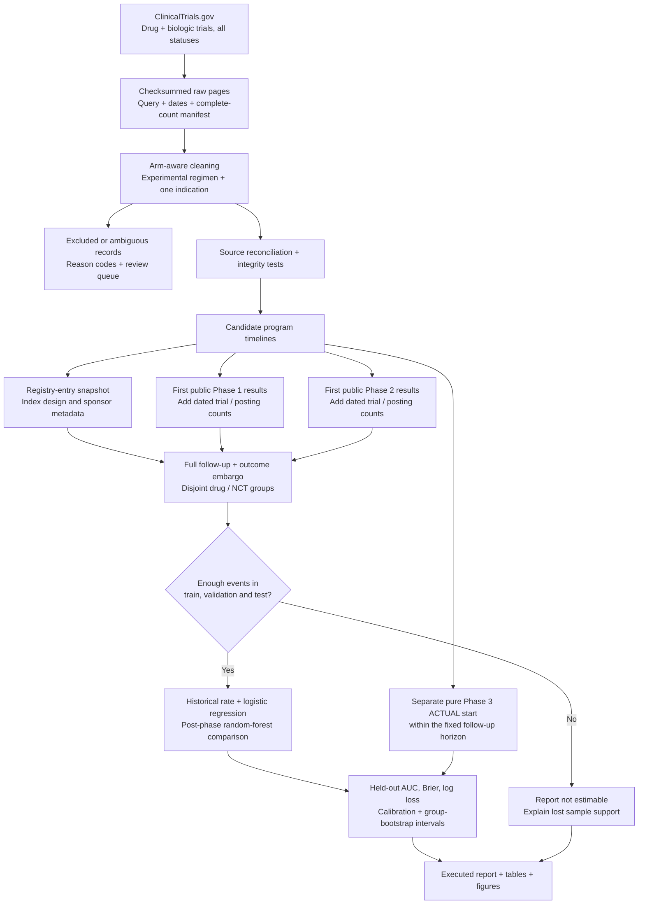

# Phase-by-Phase Drug Development Analysis

**Question:** can registry information at entry, and additional information posted
after Phase 1 or Phase 2, help predict later Phase 3 development?

The complete acquisition, organization, audit, analysis and reporting pipeline
is executable. Its identities remain **exact-label candidate programs**, not
clinically adjudicated molecular identities. Any fitted models are exploratory
retrospective estimates, not validated forecasts of approval or efficacy.

**Latest executed finding:** the full 151,081-study query was organized and
audited, but the strict longitudinal cohort has insufficient held-out events
for credible model fitting. See [the measured results](RESULTS.md).

## How the pieces fit together



Phase 1 → Phase 2 → Phase 3 → possible approval motivates the project, but is
not imposed on records: trials overlap, combine phases, and address different
indications. Approval requires separate indication-specific regulatory linkage.

## Run it

Run from the repository root with Python 3.10+:

```bash
python3 -m venv .venv
.venv/bin/python -m pip install -r phase-by-phase/requirements.txt
.venv/bin/python -m pytest -q
```

Download the complete defined cohort, clean it, audit it, and run the analysis:

```bash
PYTHONPATH=phase-by-phase/src .venv/bin/python -m phase_by_phase.run_analysis \
  --download --cutoff 2026-11-19 \
  --snapshot data/raw/phase_by_phase_full_2026-11-19 \
  --out data/processed/phase_by_phase_full_2026-11-19 \
  --horizon-years 5 --bootstrap 300
```

The public API needs no credentials. A completed snapshot is reused; interrupted
downloads resume from the last manifested page. Choose a new snapshot directory
for a different query. The acquisition preserves projected API responses, not
every optional module; detailed endpoint/safety results are not requested.

Replay saved pages with **no network request**:

```bash
PYTHONPATH=phase-by-phase/src .venv/bin/python -m phase_by_phase.run_analysis \
  --snapshot data/raw/phase_by_phase_full_2026-11-19 \
  --out data/processed/phase_by_phase_replay \
  --horizon-years 5 --bootstrap 300
```

Use a new output directory to preserve previous runs. For a quick pipeline
pilot, add `--max-studies 1000` to the download command and use separate
directories. An incomplete query **cannot train models**, because absent later
trials cannot safely become negative labels.

The old `run_first_step` command is a legacy prototype only. Its trial-wide
drug pooling and structural-only PASS are superseded by this pipeline.

## Data organization

| Table | One row per / purpose |
| --- | --- |
| trials | Every downloaded NCT, current metadata and source date precision/types |
| interventions | Intervention with raw name, type, aliases and arm assignments |
| conditions | Raw condition; no broad MeSH-to-specific-disease guessing |
| program_trials | NCT + candidate program + experimental arm |
| programs | Exact regimen + exact normalized indication |
| exclusions | Trial/arm exclusion with explicit reason |
| alias_candidates | Names awaiting identity review, not automatically applied |
| program_timelines | Candidate program's phases and dated transitions |
| snapshots | Program at registry entry or first public phase-result posting |
| analysis_splits | Mature snapshots with train/validation/test or exclusion |
| predictions | Held-out predictions, only where support requirements pass |

Outputs are Parquet. Raw/processed datasets stay outside Git; code, tests and
documentation are versioned. IDs are deterministic and raw labels are preserved.

Cleaning rules:

- A-versus-B comparator studies must not become A-plus-B regimens.
- Combine drugs only within the same experimental arm; preserve separate arms.
- Preserve Unicode and punctuation. Do not merge brand names, development codes,
  doses or formulations without reviewed evidence.
- Exclude multiple conditions and healthy-volunteer-only labels from strict
  disease-program links, retaining the source records for review.
- Explicitly exclude ambiguous arm assignments, unresolved compound/generic
  names and non-drug cointerventions.
- Preserve partial dates rather than inventing exact days.
- Account for every downloaded trial, not just successfully mapped ones.

These rules reduce false links but miss real continuations. An excluded or
differently named Phase 3 trial can become an apparent non-event.

## What is actually modeled

Endpoint: a **matching, separately registered pure Phase 3 trial with an ACTUAL
start in the next five years, within the strict linked cohort**. This is not
lifetime advancement, approval, efficacy or proof of program discontinuation.
A combined Phase 2/3 start does not date a separate Phase 3 component.

- Registry-entry baseline: later of first observed pure Phase 1 actual start and
  first public posting; not guaranteed to precede Phase 1.
- Post–Phase 1 / Phase 2: first usable public results posting for that phase.
- Do not predict Phase 3 once it has already started.
- Exclude ambiguous initial chronology and indeterminate event dates.
- Require full follow-up for both positive and negative examples; recent
  programs are censored, not labeled failures.

At each later checkpoint, compare the **same programs at the same landmark**:
index metadata + elapsed time versus those features + dated counts of earlier
trials/results postings. This tests registry-history counts, **not biological
safety/efficacy results**. The later comparator is not a replay of an initial
forecast genuinely made before Phase 1.

## How we make sure the code is correct

### Tests

`python -m pytest -q` discovers original and phase-by-phase tests. Controlled
counterexamples check independently specified invariants: comparator drugs must
not combine, future results must not enter features, immature positives must
not bypass follow-up rules, and corrupt downloads must not be used. Synthetic
fixtures test software only; they never count as empirical project findings.

### Runtime audit

Checks cover schema, null/duplicate IDs, foreign keys, page hashes, pagination
counts, complete-query status, source reconciliation, dates, identity consistency
and exclusion accounting.

- **FAIL:** structural/source-integrity error; runner exits nonzero before modeling.
- **WARN:** unresolved clinical identity/historical information; descriptive and
  explicitly exploratory analyses can continue.
- **Not estimable:** model support gate fails; no invented score is emitted.

The seeded, source-linked review queue leaves adjudication as `NOT_REVIEWED`
until an actual reviewer makes a decision.

### Holdouts and statistical evaluation

- Calendar-time train/validation/test with two full-horizon outcome gaps.
- Training labels available before validation; validation labels before test.
- Group programs sharing exact drugs **or NCT IDs** and purge overlap across
  partitions. Unknown aliases may still evade grouping.
- Fit preprocessing on training only; no class-balanced probability reweighting.
- Prespecify historical-rate, logistic and limited forest models; choose by
  validation Brier score, not the test result.
- Report test AUC, average precision, Brier score, log loss and calibration.
- Paired test-group bootstrap measures uncertainty in incremental Brier
  improvement; it does not provide an individual-drug probability interval.
- Engineering support minimums: training ≥100 rows and ≥20 of each class;
  validation/test ≥30 rows and ≥10 of each class; ≥10 groups in each partition.
  These are refusal thresholds, not a formal power calculation.

Current registry fields are not historical record versions. Date filtering
alone cannot establish prospective freedom from leakage. All fitted scores are
therefore explicitly exploratory.

## Read the results

Open `REPORT.md` in the chosen output directory for source totals, exclusions,
phase histories, mature outcomes, actual split sizes, metrics or not-estimable
reasons, and figures. `quality_audit.json` and `analysis_report.json` contain
machine-readable results. `run_manifest.json` records input/code hashes, package
versions and execution settings. See [STATUS.md](STATUS.md) for the latest run.

FDA approval, detailed safety/efficacy extraction, coefficient p-values, and
individual probability intervals remain unsupported rather than fabricated.

## What is here and what comes next

This folder contains the pipeline source and tests (`src/` and `tests/`),
[executed findings](RESULTS.md), [implementation status](STATUS.md),
[source review](SOURCE_REVIEW.md), and two interactive explainers in
[visualizations/](visualizations/): a
[pipeline walkthrough](visualizations/drug-development-walkthrough.html) and an
[analysis-methods lab](visualizations/analysis-methods-lab.html). The longer
[learning guide](https://chatgpt.com/space/page_d8723a0d42748191ac34fc65d61aee01)
is a separate ChatGPT Page, not a file in this repository.

The next steps are:

1. Review a source-linked sample of candidate programs and exclusions; measure
   false links and missed Phase 3 continuations, and adjudicate drug aliases,
   formulations, combinations, indication equivalence and repurposing.
2. Obtain historical registry versions or a defensible as-of reconstruction;
   prespecify sensitivity analyses for month-only dates rather than inventing
   exact days.
3. Rebuild timelines, five-year labels and related-program-disjoint time splits
   after identity review. Report the independent event support in every split.
4. Extract publicly dated Phase 1/2 efficacy and safety findings before claiming
   a biological evidence update. Treat indication-specific FDA approval as a
   separate linkage and outcome problem.
5. Fit and compare historical-rate, baseline and updated models only if the
   support gate passes; then assess held-out calibration, Brier score,
   discrimination and uncertainty. A coefficient p-value would not be the
   chance that an individual prediction is true.

The downloaded raw JSON and processed Parquet stay under the repository-root
`data/` directory and are Git-ignored. GitHub holds the reproducible code,
tests, documentation and visualizations, not the full dataset.

## Source and code map

- [ClinicalTrials.gov API](https://clinicaltrials.gov/data-api/api)
- [acquire.py](src/phase_by_phase/acquire.py): resumable pages, hashes and replay
- [organize.py](src/phase_by_phase/organize.py): source tables and arm-aware links
- [audit.py](src/phase_by_phase/audit.py): quality checks and review queue
- [analysis.py](src/phase_by_phase/analysis.py): landmarks, labels, holdouts and fits
- [report.py](src/phase_by_phase/report.py): report and figures
- [run_analysis.py](src/phase_by_phase/run_analysis.py): end-to-end command
- [tests](tests): function, scientific-contract, corruption and integration tests
