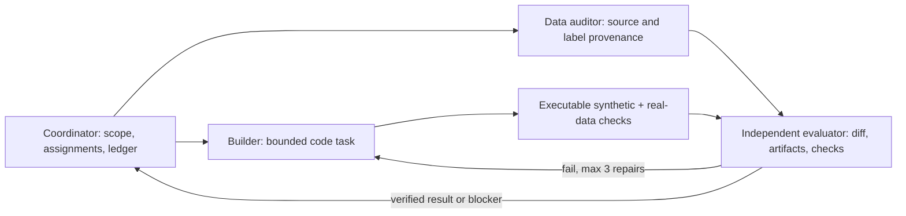
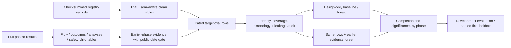
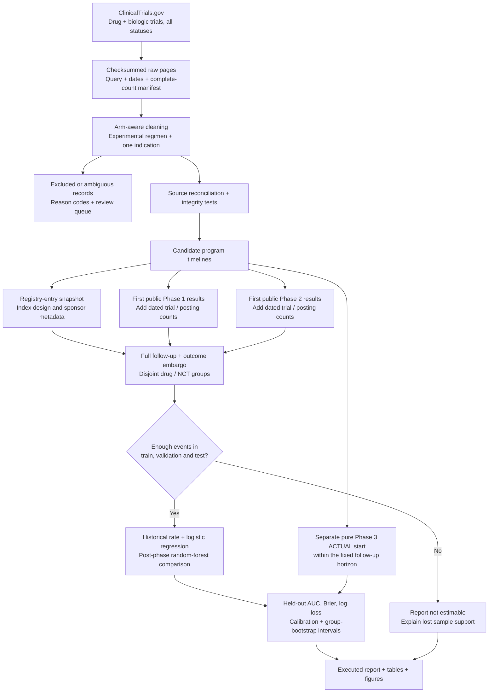

# Leo/Giannis: Phase-by-Phase Drug Trial Prediction

**Primary question:** For a trial in each clinical phase, can we predict its
eventual completion and whether a posted primary analysis is statistically
significant? For later-phase trials, does already-public structured evidence from
linked earlier trials improve those predictions beyond target-trial design and
context on the **same target rows**?

This is structured-data modeling only: no NLP, embeddings, LLM extraction, or
GPU work. Completion is distinct from reported statistical significance, which
itself is **not** proof of clinical benefit. Phase advancement remains a separate
question; it cannot be calculated by multiplying completion probabilities.

**Verified starting point:** the previous 151,081-study registry snapshot,
arm-aware candidate-program links, and five-year Phase 3 advancement audit are
preserved. That strict advancement cohort lacked sufficient events for model
fitting ([executed findings](RESULTS.md)). The slim snapshot contains no
numeric results sections, so it cannot by itself answer the new earlier-phase
evidence question. The new detail acquisition and development-only modeling
checks have run; the sections below distinguish executed results from remaining
limitations.

## New task specification and implementation status

| Prediction date | Target trial | Permitted inputs | Separate labels |
| --- | --- | --- | --- |
| At launch/first public registration | Phase 1, 2, or 3 | Target design/context only; no target final fields | Completed vs terminated/withdrawn; posted-primary-significance proxy |
| At a later phase's launch | Linked Phase 2 or 3 | Same design/context, optionally earlier-phase structured results public by that date | The same two target labels |

The at-launch comparison uses identical later-phase target trials for the
design-only and design-plus-evidence models. Missing primary p-values are
**unknown**, not non-significant. Exact-label regimen/indication links are
candidate identities, not independently verified drug-development programs.
Undated earlier evidence is excluded. Even a first results-posting date does
not prove that today's detailed result values were already present in that
version; without historical versions, such comparisons remain retrospective
and exploratory. We do not present current enrollment or results as known at
registration.

Work sequence (tracked in [the task ledger](harness/TASK_LEDGER.md)):

1. Replay the immutable, checksummed slim source; fetch full structured result
   records into a separate resumable, checksummed snapshot. Start with a small
   real pilot, then scale to the eligible result-bearing records.
2. Build one-row-per-trial metadata plus child tables for result arms,
   participant flow, outcomes, analyses and adverse events. Preserve arm IDs,
   units, denominators, p-value qualifiers, missingness and source dates.
3. Build phase-specific dated prediction rows and label-coverage/cleaning
   funnels. Audit time order, duplicate IDs, one-to-many joins, group overlap,
   outcome availability and historical-version limitations.
4. On development data, compare prevalence and prespecified random-forest
   models separately for completion and significance, by phase. Compare
   design-only against added earlier evidence on matched target rows, using
   ROC-AUC, average precision, Brier/log loss, calibration and uncertainty
   only where class support permits.
5. Keep final-test outcomes sealed through development. Freeze inputs, splits,
   code and settings before one final evaluation. A weak score is a finding,
   not permission to retune against the same holdout. Unsupported phase/task
   cohorts receive explicit not-estimable reports.

The coordinator assigns bounded coding tasks; a data auditor checks sources and
labels; a builder implements; an independent evaluator runs checks and inspects
artifacts. The loop is build → run → evaluate → repair → rerun, at most three
repair rounds per task. See [execution rules](harness/EXECUTION_RULES.md).



### New structured-data commands (executed pilot)

Run from the repository root with the existing project virtual environment:

```bash
python3 phase-by-phase/harness/check.py
PYTHONPATH=phase-by-phase/src .venv/bin/python -m pytest -q phase-by-phase/tests
PYTHONPATH=phase-by-phase/src .venv/bin/python -m phase_by_phase.fetch_details \
  --trials data/processed/phase_by_phase_final_2026-11-19/trials.parquet \
  --out phase-by-phase/data/raw/details_exact_pilot_2026-11-23 \
  --ids NCT00586339 NCT01627561 NCT00844415 NCT01895777
PYTHONPATH=phase-by-phase/src .venv/bin/python -m phase_by_phase.run_structured \
  --source data/raw/phase_by_phase_full_2026-11-19 \
  --details phase-by-phase/data/raw/details_exact_pilot_2026-11-23 \
  --out phase-by-phase/data/processed/structured_exact_pilot_2026-11-23 \
  --selected-only
PYTHONPATH=phase-by-phase/src .venv/bin/python -m phase_by_phase.model_structured \
  --dataset phase-by-phase/data/processed/structured_exact_pilot_2026-11-23 \
  --out phase-by-phase/data/processed/structured_exact_pilot_2026-11-23/development_evaluation.json
```

Choose **new** output paths for a fresh run; commands refuse to overwrite
previous artifacts. `--selected-only` is a pilot, not a complete-query model
cohort. Omitting it replays and cleans all source metadata while enriching only
the IDs present in the detail snapshot. The detail fetcher is resumable and
checksummed; `--per-phase-year 40 --before-year 2024` selects a deterministic
development-only acquisition sample without consulting outcome labels. Generated
data under `phase-by-phase/data/` are Git-ignored.

The pilot produces `trials.parquet`, `interventions.parquet`, `conditions.parquet`,
`program_trials.parquet`, `programs.parquet`, `exclusions.parquet`, and
`alias_candidates.parquet`, plus `result_arms.parquet`,
`participant_flow.parquet`, `outcomes.parquet`, `analyses.parquet`,
`adverse_events.parquet`, and `prediction_rows.parquet`. The accompanying
`quality_audit.json`, `feature_coverage.json`, `run_manifest.json`, and
`development_evaluation.json` distinguish structural integrity, actual field
coverage, hashes, and model support.

**Observed exact-date pilot:** four full result records and four dated trial
rows; 204 result-arm, 56 participant-flow, 4,442 outcome, four statistical
analysis and 648 adverse-event child rows. Three completion labels and one
significance label are known. Structural audit PASS, overall WARN because
clinical identity and historical versions remain unvalidated. Strict
earlier-phase evidence count is zero: the current detailed records were revised
after the later trials' prediction dates. All six phase/task model cells are
explicitly **not estimable**; no real-data AUC is claimed. Independent review
passed the synthetic and real extraction checks but classed model performance
as blocked/partial on this pilot.

**Observed scaled replay (2026-11-23):** a deterministic, outcome-blind
phase/year sample of 2,280 full result records was downloaded and checksummed.
The replay matched 2,279 records to the source snapshot's posting/update dates;
one revised record (`NCT02192359`) was excluded, not silently merged. Running
the updated pipeline against the full **151,081-trial** previously cleaned
cohort produced 65,372 result-arm, 46,688 participant-flow, 160,142 outcome,
9,380 analysis, and 575,441 adverse-event child rows. It produced 29,909
development-period prediction rows (10,138 Phase 1; 12,142 Phase 2; 7,629
Phase 3), with 14,128 known completion labels but only **67** known
significance-proxy labels. The full-cohort structural audit passed; overall
status remains WARN for clinical identity and historical availability. This is
**not** full result-detail acquisition: 2,280 records were enriched, while the
slim source marks 40,796 records as having results. Local Git-ignored outputs
include `feature_coverage.json`, `quality_audit.json`, and `run_manifest.json`
with checksums for every derived data artifact. The development model report
is generated separately and is not final-holdout performance.

**Independent development evaluation on that full-cohort replay:** completion
models met the development support gate, but their validation discrimination
was weak. These are validation findings, **not** final-test scores or calibrated
individual success probabilities.

| Completion task | Train / validation rows | Prevalence Brier | Design-forest AUC | Design-forest Brier |
| --- | ---: | ---: | ---: | ---: |
| Phase 1 | 2,043 / 1,131 | .09883 | .56070 | .09926 |
| Phase 2 | 1,402 / 646 | .17213 | .56774 | .16942 |
| Phase 3 | 1,095 / 457 | .10917 | .54643 | .10833 |

The Phase 1 forest's Brier score is worse than simply predicting training
prevalence; Phase 2 and 3 improvements are small. All three significance tasks
are **not estimable** (only 4/4/8 training rows for Phases 1/2/3 after temporal
label-availability rules). The matched earlier-evidence comparison is also not
estimable: Phase 3 has zero eligible training rows and only two validation
rows with strict prior evidence. There is no p-value proving a 75% individual
probability, and AUC must not be read as such a probability. The report is
`phase-by-phase/data/processed/structured_full_plus_2280_2026-11-23/development_evaluation.json`
in local Git-ignored data. Registry revisions and candidate identity linkage
still limit historical interpretation.

The larger replay reuses and re-audits the earlier immutable cleaned tables:

```bash
PYTHONPATH=phase-by-phase/src .venv/bin/python -m phase_by_phase.fetch_details \
  --trials data/processed/phase_by_phase_final_2026-11-19/trials.parquet \
  --out phase-by-phase/data/raw/details_phase_year_40_2026-11-23 \
  --per-phase-year 40 --before-year 2024
PYTHONPATH=phase-by-phase/src .venv/bin/python -m phase_by_phase.run_structured \
  --source data/raw/phase_by_phase_full_2026-11-19 \
  --cleaned data/processed/phase_by_phase_final_2026-11-19 \
  --details phase-by-phase/data/raw/details_phase_year_40_2026-11-23 \
  --out phase-by-phase/data/processed/structured_full_plus_2280_2026-11-23
PYTHONPATH=phase-by-phase/src .venv/bin/python -m phase_by_phase.model_structured \
  --dataset phase-by-phase/data/processed/structured_full_plus_2280_2026-11-23 \
  --out phase-by-phase/data/processed/structured_full_plus_2280_2026-11-23/development_evaluation.json
```

The fixed development split is prediction before 2020 for training, 2020–2023
for validation, and 2024 onward as a **sealed** holdout. Training labels must
have an available version date before 2020; validation labels before 2024.
Exact drug groups overlapping training are purged from validation. The
prevalence baseline and prespecified 200-tree random forest use train-only
imputation/encoding. Supported cohorts report ROC-AUC, average precision,
Brier, log loss, five calibration bins, a 0.5-threshold confusion matrix, and
paired group-bootstrap Brier differences for the matched-row evidence
comparison. Unsupported cohorts report counts and refusal reasons. The final
holdout is not evaluated by this development command.

## How the pieces fit together

The new phase-specific experiment is:



The **previously executed advancement analysis**, retained for reproducibility,
has a different label and support gate:



Phase 1 → Phase 2 → Phase 3 → possible approval motivates the project, but is
not imposed on records: trials overlap, combine phases, and address different
indications. Approval requires separate indication-specific regulatory linkage.

## Previous advancement pipeline (executed)

Run from the repository root with Python 3.10+:

```bash
python3 -m venv .venv
.venv/bin/python -m pip install -r phase-by-phase/requirements.txt
.venv/bin/python -m pytest -q
```

Download the complete defined cohort, clean it, audit it, and run the analysis:

```bash
PYTHONPATH=phase-by-phase/src .venv/bin/python -m phase_by_phase.run_analysis \
  --download --cutoff 2026-11-19 \
  --snapshot data/raw/phase_by_phase_full_2026-11-19 \
  --out data/processed/phase_by_phase_full_2026-11-19 \
  --horizon-years 5 --bootstrap 300
```

The public API needs no credentials. A completed snapshot is reused; interrupted
downloads resume from the last manifested page. Choose a new snapshot directory
for a different query. The acquisition preserves projected API responses, not
every optional module; detailed endpoint/safety results are not requested.

Replay saved pages with **no network request**:

```bash
PYTHONPATH=phase-by-phase/src .venv/bin/python -m phase_by_phase.run_analysis \
  --snapshot data/raw/phase_by_phase_full_2026-11-19 \
  --out data/processed/phase_by_phase_replay \
  --horizon-years 5 --bootstrap 300
```

Use a new output directory to preserve previous runs. For a quick pipeline
pilot, add `--max-studies 1000` to the download command and use separate
directories. An incomplete query **cannot train models**, because absent later
trials cannot safely become negative labels.

The old `run_first_step` command is a legacy prototype only. Its trial-wide
drug pooling and structural-only PASS are superseded by this pipeline.

## Data organization

| Table | One row per / purpose |
| --- | --- |
| trials | Every downloaded NCT, current metadata and source date precision/types |
| interventions | Intervention with raw name, type, aliases and arm assignments |
| conditions | Raw condition; no broad MeSH-to-specific-disease guessing |
| program_trials | NCT + candidate program + experimental arm |
| programs | Exact regimen + exact normalized indication |
| exclusions | Trial/arm exclusion with explicit reason |
| alias_candidates | Names awaiting identity review, not automatically applied |
| program_timelines | Candidate program's phases and dated transitions |
| snapshots | Program at registry entry or first public phase-result posting |
| analysis_splits | Mature snapshots with train/validation/test or exclusion |
| predictions | Held-out predictions, only where support requirements pass |

Outputs are Parquet. Raw/processed datasets stay outside Git; code, tests and
documentation are versioned. IDs are deterministic and raw labels are preserved.

Cleaning rules:

- A-versus-B comparator studies must not become A-plus-B regimens.
- Combine drugs only within the same experimental arm; preserve separate arms.
- Preserve Unicode and punctuation. Do not merge brand names, development codes,
  doses or formulations without reviewed evidence.
- Exclude multiple conditions and healthy-volunteer-only labels from strict
  disease-program links, retaining the source records for review.
- Explicitly exclude ambiguous arm assignments, unresolved compound/generic
  names and non-drug cointerventions.
- Preserve partial dates rather than inventing exact days.
- Account for every downloaded trial, not just successfully mapped ones.

These rules reduce false links but miss real continuations. An excluded or
differently named Phase 3 trial can become an apparent non-event.

## What is actually modeled

Endpoint: a **matching, separately registered pure Phase 3 trial with an ACTUAL
start in the next five years, within the strict linked cohort**. This is not
lifetime advancement, approval, efficacy or proof of program discontinuation.
A combined Phase 2/3 start does not date a separate Phase 3 component.

- Registry-entry baseline: later of first observed pure Phase 1 actual start and
  first public posting; not guaranteed to precede Phase 1.
- Post–Phase 1 / Phase 2: first usable public results posting for that phase.
- Do not predict Phase 3 once it has already started.
- Exclude ambiguous initial chronology and indeterminate event dates.
- Require full follow-up for both positive and negative examples; recent
  programs are censored, not labeled failures.

At each later checkpoint, compare the **same programs at the same landmark**:
index metadata + elapsed time versus those features + dated counts of earlier
trials/results postings. This tests registry-history counts, **not biological
safety/efficacy results**. The later comparator is not a replay of an initial
forecast genuinely made before Phase 1.

## How we make sure the code is correct

### Tests

`python -m pytest -q` discovers original and phase-by-phase tests. Controlled
counterexamples check independently specified invariants: comparator drugs must
not combine, future results must not enter features, immature positives must
not bypass follow-up rules, and corrupt downloads must not be used. Synthetic
fixtures test software only; they never count as empirical project findings.

### Runtime audit

Checks cover schema, null/duplicate IDs, foreign keys, page hashes, pagination
counts, complete-query status, source reconciliation, dates, identity consistency
and exclusion accounting.

- **FAIL:** structural/source-integrity error; runner exits nonzero before modeling.
- **WARN:** unresolved clinical identity/historical information; descriptive and
  explicitly exploratory analyses can continue.
- **Not estimable:** model support gate fails; no invented score is emitted.

The seeded, source-linked review queue leaves adjudication as `NOT_REVIEWED`
until an actual reviewer makes a decision.

### Holdouts and statistical evaluation

- Calendar-time train/validation/test with two full-horizon outcome gaps.
- Training labels available before validation; validation labels before test.
- Group programs sharing exact drugs **or NCT IDs** and purge overlap across
  partitions. Unknown aliases may still evade grouping.
- Fit preprocessing on training only; no class-balanced probability reweighting.
- Prespecify historical-rate, logistic and limited forest models; choose by
  validation Brier score, not the test result.
- Report test AUC, average precision, Brier score, log loss and calibration.
- Paired test-group bootstrap measures uncertainty in incremental Brier
  improvement; it does not provide an individual-drug probability interval.
- Engineering support minimums: training ≥100 rows and ≥20 of each class;
  validation/test ≥30 rows and ≥10 of each class; ≥10 groups in each partition.
  These are refusal thresholds, not a formal power calculation.

Current registry fields are not historical record versions. Date filtering
alone cannot establish prospective freedom from leakage. All fitted scores are
therefore explicitly exploratory.

## Read the results

Open `REPORT.md` in the chosen output directory for source totals, exclusions,
phase histories, mature outcomes, actual split sizes, metrics or not-estimable
reasons, and figures. `quality_audit.json` and `analysis_report.json` contain
machine-readable results. `run_manifest.json` records input/code hashes, package
versions and execution settings. See [STATUS.md](STATUS.md) for the latest run.

FDA approval, detailed safety/efficacy extraction, coefficient p-values, and
individual probability intervals remain unsupported rather than fabricated.

## What is here and what comes next

This folder contains the pipeline source and tests (`src/` and `tests/`),
[executed findings](RESULTS.md), [implementation status](STATUS.md),
[source review](SOURCE_REVIEW.md), and two interactive explainers in
[visualizations/](visualizations/): a
[pipeline walkthrough](visualizations/drug-development-walkthrough.html) and an
[analysis-methods lab](visualizations/analysis-methods-lab.html). The longer
[learning guide](https://chatgpt.com/space/page_d8723a0d42748191ac34fc65d61aee01)
is a separate ChatGPT Page, not a file in this repository.

The next steps are:

1. Review a source-linked sample of candidate programs and exclusions; measure
   false links and missed Phase 3 continuations, and adjudicate drug aliases,
   formulations, combinations, indication equivalence and repurposing.
2. Obtain historical registry versions or a defensible as-of reconstruction;
   prespecify sensitivity analyses for month-only dates rather than inventing
   exact days.
3. Rebuild timelines, five-year labels and related-program-disjoint time splits
   after identity review. Report the independent event support in every split.
4. Extract publicly dated Phase 1/2 efficacy and safety findings before claiming
   a biological evidence update. Treat indication-specific FDA approval as a
   separate linkage and outcome problem.
5. Fit and compare historical-rate, baseline and updated models only if the
   support gate passes; then assess held-out calibration, Brier score,
   discrimination and uncertainty. A coefficient p-value would not be the
   chance that an individual prediction is true.

The downloaded raw JSON and processed Parquet stay under the repository-root
`data/` directory and are Git-ignored. GitHub holds the reproducible code,
tests, documentation and visualizations, not the full dataset.

## Source and code map

- [ClinicalTrials.gov API](https://clinicaltrials.gov/data-api/api)
- [acquire.py](src/phase_by_phase/acquire.py): resumable pages, hashes and replay
- [organize.py](src/phase_by_phase/organize.py): source tables and arm-aware links
- [audit.py](src/phase_by_phase/audit.py): quality checks and review queue
- [analysis.py](src/phase_by_phase/analysis.py): landmarks, labels, holdouts and fits
- [report.py](src/phase_by_phase/report.py): report and figures
- [run_analysis.py](src/phase_by_phase/run_analysis.py): end-to-end command
- [tests](tests): function, scientific-contract, corruption and integration tests
