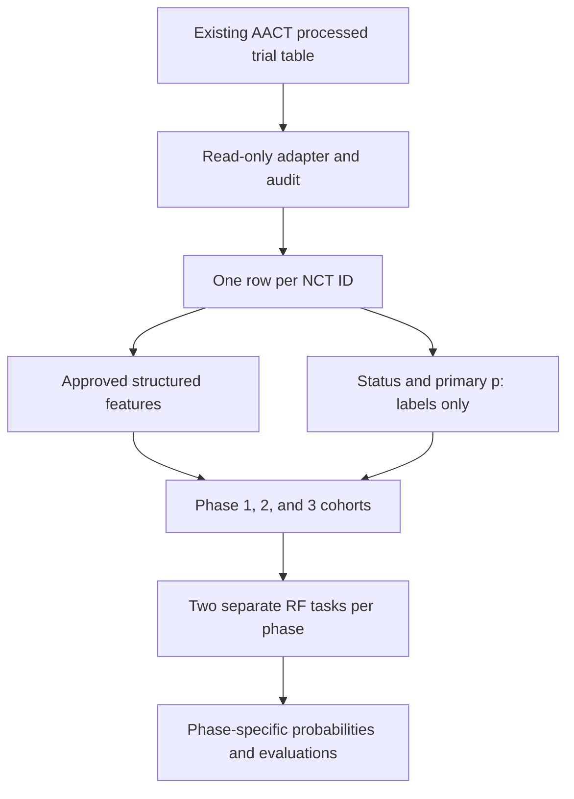
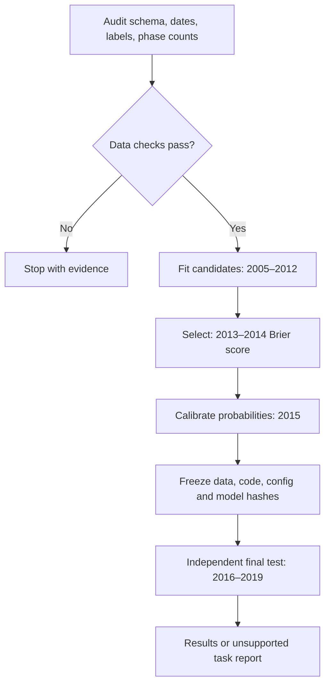
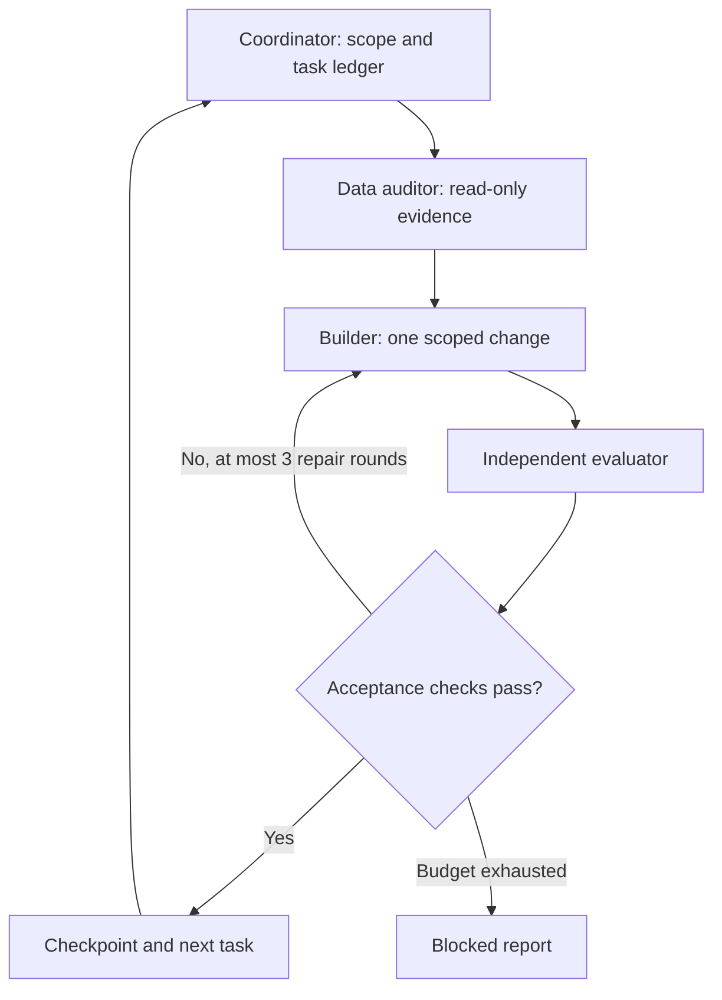

# Leo's phase-by-phase random forest harness

Prepared November 23, 2026. This package belongs **only inside
`phase-by-phase/harness/`**. It reads the current dataset without changing the
broader repository, root notebook, SQL, or existing model implementation.

## Lessons carried forward from the existing work

Read [LESSONS_FROM_EXISTING_WORK.md](LESSONS_FROM_EXISTING_WORK.md) for the team's
findings, data issues, and the exact implemented or pending implications for
this phase-by-phase design. Agent instructions require this evidence review;
pooled results are never presented as new phase-specific results.

## Decision

Start with one trial per row, and six phase-specific random forests:

| Trial phase | Completion task | Significance task |
|---|---|---|
| Phase 1 | Completed vs terminated/withdrawn | Any reported primary-analysis numeric p < .05, among completed reporters |
| Phase 2 | Same definition, Phase 2 only | Same definition, Phase 2 only |
| Phase 3 | Same definition, Phase 3 only | Same definition, Phase 3 only |

Phase 1 often emphasizes safety/dose rather than statistical efficacy. If its
significance subset is too sparse, mark that task unsupported. Combined phases
and early Phase 1 are counted separately and excluded from these six tasks.
They are never copied into more than one phase.

This answers what happens **within a trial's registered phase**. A registered
Phase 1 trial does not itself become a Phase 2 trial; a related development
program may start another study. Keep Leo's eventual highest-phase goal as an
explicit later label task within this extension. Completion/significance
probabilities cannot be multiplied to estimate the highest phase reached.

## How information reaches the models



The input is the existing `data/processed/trials.parquet`, already produced by
the broader project. No new scraping or data joins run here. If it is not
available, this harness stops; it does not substitute synthetic research data.
The separate phase-by-phase pilot metadata alone lacks the full processed
features/primary p-values and is not silently treated as equivalent input.

The allowlist is in policy.py: sponsor category, allocation, masking, trial
design, arms, counts of planned endpoints/interventions/conditions, structured
eligibility age/gender, disease category, start year, and limited prior sponsor
counts. There are no text/embedding/external-source features. Phase is a routing
key, NCT ID an identity key; neither enters a phase-specific RF as a feature.

**Excluded after independent audit:** the existing sponsor stop-rate is smoothed
using outcomes through 2015. It would contaminate the new fit<=2012 and
validation2013–14 partitions. It is excluded until rebuilt with a permitted
prior. Final enrollment, sites, post_* fields, results, status, label_* fields,
registration lag, text-derived eligibility fields, and outcome labels are also
excluded as inputs.

## What existing source code actually does

Inspected main at tree `64d39a4e4ea458cad8bf229fb8d2732cc5284987` and the
phase-by-phase branch named below.

- `sql/trials.sql` selects final-status interventional drug trials starting
  2005–2019. Its significance field is MIN(p) across reported primary analyses.
- `src/dtp/features.py` makes `met_primary` available only for completers with
  a primary p-value. The design group also contains text-derived eligibility
  features; reusing the whole group would violate strict no-NLP scope.
- `src/dtp/models.py` has reusable patterns, but its default run also includes
  a deliberately leaky-sites diagnostic. This new runner does not call it.
- The branch STATUS says historical snapshots and transition models are not
  implemented and candidate links can conflate comparator drugs. This study
  does not depend on those program identities.

Sources:
- https://github.com/jbajaj6/DrugTrialPredictor/blob/main/src/dtp/features.py
- https://github.com/jbajaj6/DrugTrialPredictor/blob/main/src/dtp/models.py
- https://github.com/jbajaj6/DrugTrialPredictor/blob/main/sql/trials.sql
- https://github.com/jbajaj6/DrugTrialPredictor/blob/agents/mkae-it-a-new-directory-and-connect-it/phase-by-phase/STATUS.md

## How a run proceeds



The RF starts with 300 trees, minimum 5 or 10 observations per leaf, unrestricted
or depth-12 trees, and unweighted/balanced candidates. Four configurations are
prespecified in config.json; seed=545; max two CPU jobs per forest. Choose on
validation Brier score to prioritize probability accuracy. Calibrate using a
separate 2015 sigmoid fit, without refitting the forest. The .5 classification
threshold is fixed. These are starting design choices, not proven optimal ones.

At least 20 positive and 20 negative labels in each required partition is a
conservative feasibility gate, not a guarantee of power. Sparse tasks remain
unsupported. Do not expand a search, pool phases, or alter labels to manufacture
a six-model result.

Median imputation/missing flags and categorical encoding fit on training only.
No scaling is needed for RF. The input file, configuration, source, and model
hashes are frozen. Test evaluation consumes a one-use marker. Test metrics must
not trigger model tuning or agent repair rounds. This is an accidental-use
guard; process/tool permissions must additionally isolate the final evaluator
if running fully autonomous agents.

## How the agents work



AGENTS.md and agents/roles.md are executable instructions for an existing
Codex or Claude Code agent session. The coordinator assigns narrow tasks and
artifacts; only independent tasks run concurrently; one writer owns each file.
Agents run deterministic code and inspect its artifacts. The ML experiment is
reproducible without agent calls. There is no paid provider adapter or
unattended agent service in this starter.

For the first agent session, use this task:

> Work only inside phase-by-phase. Read harness/AGENTS.md and tasklist.json.
> Locate the existing processed trial dataset read-only. Have a data auditor
> produce the phase/target/split audit. Have a builder implement any failing
> acceptance item, and a separate evaluator reproduce its checks. Maximum three
> repair rounds per item. Do not run final-test evaluation until integration
> checks and the real audit pass and the experiment is frozen. Do not change
> the broader project or add NLP. Record blocked work explicitly.

## Evaluation outputs

`audit.json`: cohort counts, class balance, Q2 coverage, feature missingness,
phase exclusions and limitations. `trace.jsonl`: stages, candidate validation
scores and failures. `frozen.json`: selected parameters, hashes and task states.
`*_split_manifest.csv`: NCT IDs and fixed partition assignments.
`test_report.json`: per-phase/target metrics, prevalence comparator, probability
calibration bins, ROC interval and paired Brier improvement interval.
`*_predictions.csv`: observed and predicted values for the evaluator's report.

No invented AUC threshold decides research success. If RF does not improve over
the prevalence baseline, report that result. See evals/acceptance.md for agent
checks and unimplemented integration/sensitivity evaluations.

## Scientific limits the harness must display

1. Current AACT fields can change after registration. The initial run is a
   **retrospective current-record evaluation**, not a validated historical
   registration-time forecast. The 90-day registration filter does not fix this.
2. Start-year splits do not establish that old trial labels were available at
   the simulated historical training date. A prospective backtest requires
   availability dates and historical snapshots, not present in this input.
3. MIN(p)<.05 means at least one reported primary analysis is significant. It
   does not establish beneficial direction, all co-primary endpoints attained,
   multiplicity control, clinical importance, or approval. The collapsed table
   lacks full p-value inequality qualifiers. Keep the current numeric proxy
   explicit; a more rigorous significance label requires a later label audit.
4. Missing results are unknown. Q2 only describes the selected reporting subset.
   Show its coverage by phase; do not generalize it to every trial.
5. Only final-status rows are present, so unfinished/long-running trials can be
   underrepresented. Completion is eventual final status among observed finals,
   not completion within a fixed time horizon.
6. Unique NCT IDs prevent row duplication, not correlations between related
   drug/sponsor trials. Current bootstrap is by trial; grouped sensitivity
   analysis remains a later evaluation, not an implemented guarantee.
7. Previous pooled Q1/Q2 AUCs do not establish the six phase-specific results.

## Current agent guidance applied

Checked official sources on November 23, 2026. These are engineering
recommendations adapted to this project, not mandatory provider rules.

| Official guidance | Application here |
|---|---|
| Anthropic harness design: planner/generator/evaluator, tractable tasks, structured handoffs | Coordinator, scoped builder and independent evaluator; task ledger and progress checkpoints |
| Anthropic long-running harnesses: persistent progress and testable acceptance items | AGENTS.md, tasklist.json, progress.jsonl, explicit implementation/tested/blocked states |
| Anthropic evals: objective code graders plus calibrated judgment | Deterministic label/leakage checks; independent review for scientific interpretation |
| OpenAI multi-agent: delegate independent questions; coordinate shared writes | Read-only reviews may run concurrently; dependent pipeline and mutations stay sequential |
| OpenAI evals: inspect traces, then repeatable datasets/evals | JSONL trace first; fixed fixtures and real audit; frozen final evaluation |

Sources:
- https://www.anthropic.com/research/harness-design-long-running-apps
- https://www.anthropic.com/research/effective-harnesses-for-long-running-agents
- https://www.anthropic.com/research/demystifying-evals-for-ai-agents
- https://developers.openai.com/api/docs/guides/agents-api/multi-agent
- https://developers.openai.com/api/docs/guides/agent-evals
- https://scikit-learn.org/stable/modules/generated/sklearn.ensemble.RandomForestClassifier.html

## Installation and commands

Copy this folder's contents into `phase-by-phase/harness/` in the existing
checkout. This creates files only under Leo's extension. Use the project's
Python environment; if dependencies are missing, install requirements into
that environment rather than changing the broader dependency manifest.

From `phase-by-phase/harness/`:

```bash
python -m unittest discover -s tests -v
python -m compileall -q policy.py run.py
python run.py audit --data ../../data/processed/trials.parquet --out ../outputs/phase_rf_v1
python run.py train --data ../../data/processed/trials.parquet --out ../outputs/phase_rf_v1 --retrospective
# Evaluator only, after the integration checks and real-data audit pass:
python run.py evaluate --data ../../data/processed/trials.parquet --out ../outputs/phase_rf_v1
```

Do not load joblib models from untrusted sources. The evaluator only consumes
locally generated, hash-matched models from its frozen run.

## Implementation status

Implemented: isolated scope, policies, explicit feature allowlist, audit/train/
evaluate CLI, bounded agent runbook, four-candidate RF selection, calibration,
freeze manifests, final-test guard, JSON/CSV output, 25 regression tests.

Verified in this workspace: policy tests and compilation (see progress.jsonl).
Not verified here: pandas/sklearn execution or real-data models. The current
workspace has neither the dataset nor those ML dependencies. Run the explicit
integration cases before using this for research results. No trained model,
new AUC, or live agent service is claimed.

## Enforced data separation

The forest fits only 2005–2012 rows; model selection uses 2013–2014; a separate
calibrator fits only 2015; final evaluation uses 2016–2019. Preprocessing is
training-fitted. Test rows are removed before constructing development task
frames; test labels/rates are withheld from development audit output. Every
run verifies unique NCT IDs, year-to-partition assignment and split integrity.
If a validated leakage_group_id is supplied, cross-partition related groups
also fail. Provisional program links are not accepted as verified groups.
Absent a verified group, only NCT-level separation is established. The frozen
input/code/config/model hashes and one-use test marker still apply.
